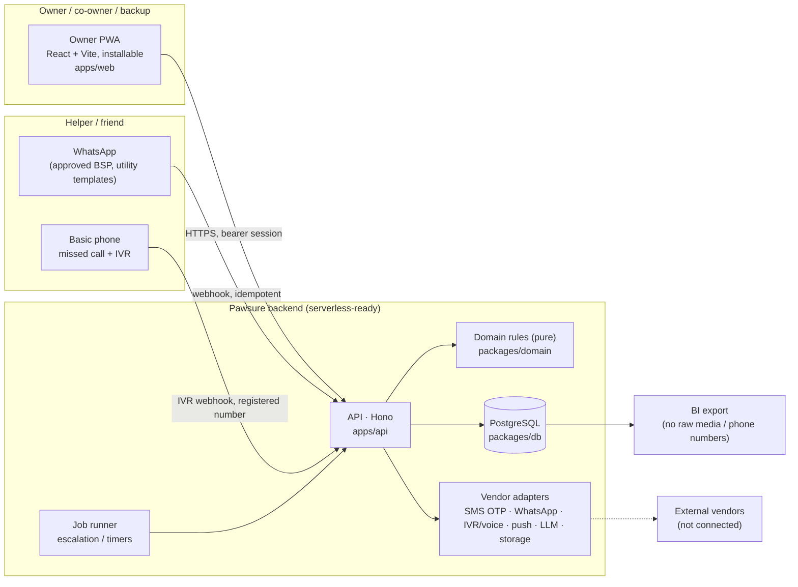
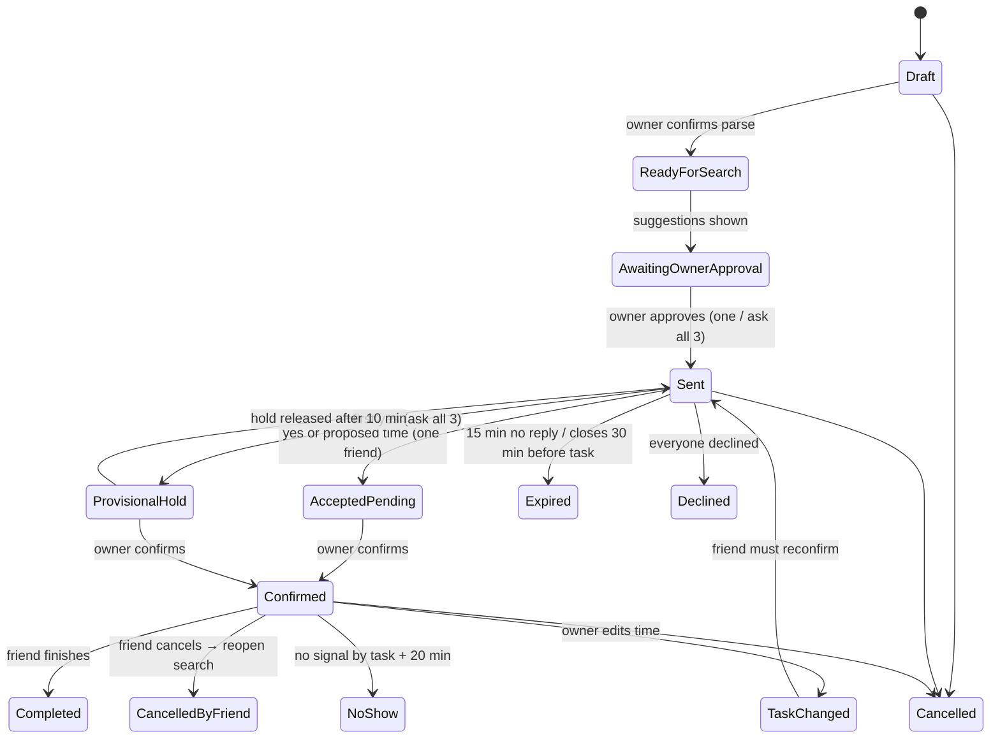
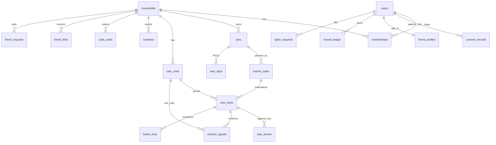

# Architecture (Phase 0)

Source of truth: Pawsure PRD v1.3 and *Master Prompt 2: P0 mobile application*. This records the build as it stands, plus the decisions still open. Vendors aren't selected; every external service sits behind an adapter interface with a mock (`apps/api/src/adapters.ts`).

## System view



| Layer | Choice in this repo | Pilot production target (open decision D-01) |
|---|---|---|
| Owner client | React 18 + Vite PWA (`vite-plugin-pwa`, service worker, offline banner) | Same; host on any static CDN in an India region |
| API | Hono on Node (`@hono/node-server`); the handlers are runtime-agnostic | Serverless functions (Vercel / Cloud Run / AWS Lambda) |
| Rules | `@pawsure/domain`: pure TypeScript, no I/O, unit-tested | Same package, shared by API, jobs and web |
| Database | PostgreSQL schema; **PGlite** locally (no Docker needed) | Managed PostgreSQL, India region, encrypted, PITR |
| Jobs | `POST /jobs/escalations` (idempotent; dedupe keys); `jobs` table for a durable queue | Scheduler every minute plus the queue worker (`SKIP LOCKED`) |
| Messaging, OTP, IVR, LLM | Mock adapters that record to an outbox | Vendors chosen on quotes, template approval, DPA, data location |

## Request flow: a helper photo becomes a confidence label

```mermaid
sequenceDiagram
  participant H as Helper (WhatsApp)
  participant BSP as WhatsApp BSP
  participant API
  participant DB
  participant D as Domain rules
  H->>BSP: Photo reply to the task prompt
  BSP->>API: POST /webhooks/whatsapp (messageId)
  API->>DB: sender = registered helper of this task? consent granted?
  API->>DB: insert checkin_signals (idempotency_key = wa:messageId, event_time, received_time, image_hash)
  Note over API,DB: duplicate key → "duplicate_event"; known image hash → stored but never counts
  API->>DB: append task_events "Done with evidence"
  Note over API,D: Later, the owner opens Today
  API->>DB: load tasks, signals, visit calls
  API->>D: evaluateVisit + evaluateTask (rule set confidence-v1)
  D-->>API: Confirmed / Likely / Not confirmed … + reason codes
```

## Friend Finder state machine (PRD 9.4)



Implemented as a pure reducer in `packages/domain/src/friendfinder/stateMachine.ts`, with 10 tests covering timers, races, idempotency, late replies, cancellation, no-show and task changes.

## Data model (summary ERD)



The full DDL is in `packages/db/migrations/001_init.sql`. These rules are enforced in the schema itself:

- **Tenant boundary.** Every household-owned row carries `household_id`. A helper in two homes has two `memberships` rows, and consent is recorded per household.
- **Time.** `event_time` and `received_time` are stored separately. Care days are IST dates.
- **Append-only history.** `audit_log`, `task_events` and `consent_records` reject UPDATE and DELETE through a trigger; a test proves it.
- **Idempotency.** `checkin_signals.idempotency_key`, `notifications.dedupe_key`, `inbound_messages.message_id` and `jobs.idempotency_key` are all unique.
- **Rule versions.** `care_days.rule_version` is part of the primary key, so a new rule never back-fills old days.

## Notification matrix (P0 defaults)

| Event | Severity | Recipient | Channel | Retries / timing | Dedupe key | Fallback |
|---|---|---|---|---|---|---|
| Task prompt | — | Helper | WhatsApp utility template (en/hi/mr) | One, 10 min before due | `prompt:{task}` | IVR call script if WhatsApp is down |
| Missed check-in, step 1 | Standard / medicine / walk | Owner | Push + WhatsApp | Due +30 / +15 / +45 | `esc:{task}:1` | SMS |
| Step 2 | — | Backup (never for medicine tasks, D-10) | WhatsApp 15-min look-in link | Step 1 + 30 min if not acknowledged | `esc:{task}:2` | Automated call |
| Step 3 | — | Owner | Push | Step 1 + 45 min | `esc:{task}:3` | — |
| Incident S1 | Urgent | Owner + backup, then whole circle | WhatsApp + automated call | Repeat calls every 5 min ×3; all at 15 min; ops case at once | `inc:{id}:{step}` | No quiet hours |
| Incident S2 | Unwell | Owner → backup | WhatsApp + push → call | Backup +15; calls + ops +30 | `inc:{id}:{step}` | — |
| Incident S3 | Practical | Owner → backup | WhatsApp + push | Backup +30 | `inc:{id}:{step}` | — |
| Friend request | — | Friend | WhatsApp template in their language | Reminder at 8 min; expiry 15 min | `ff:{req}:{friend}:{n}` | — |
| Friend cancelled | — | Owner | Push | Within 30 s | `ff:{req}:cancel` | SMS |
| Revocation | — | Removed member | All channels | ≤ 60 s | `revoke:{membership}` | — |

Acknowledgement means an explicit "I'm on it" tap or pressing 1 on a call. A delivery or read receipt never counts.
