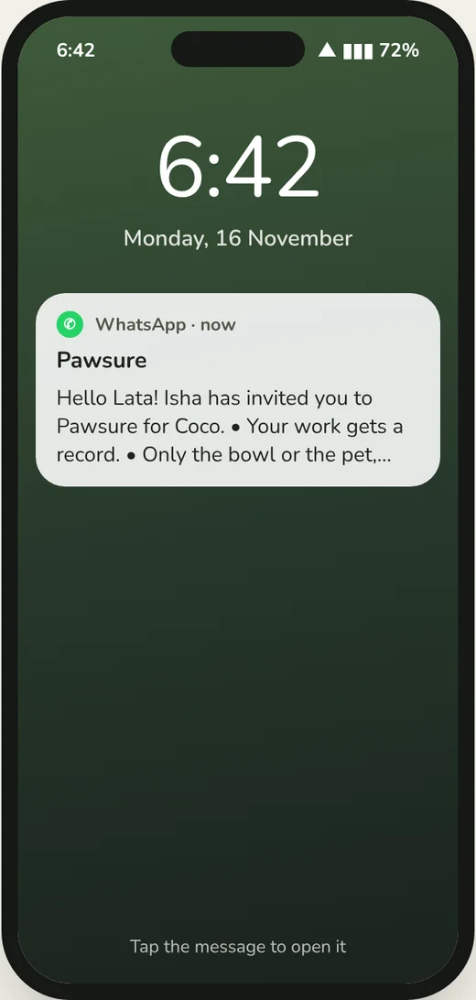
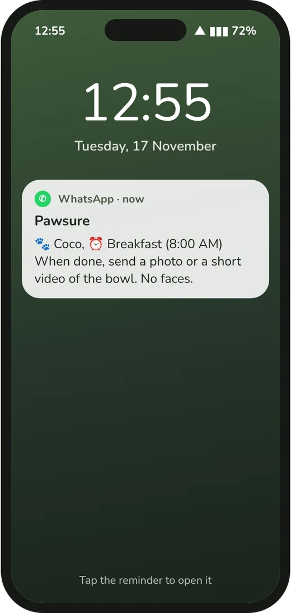
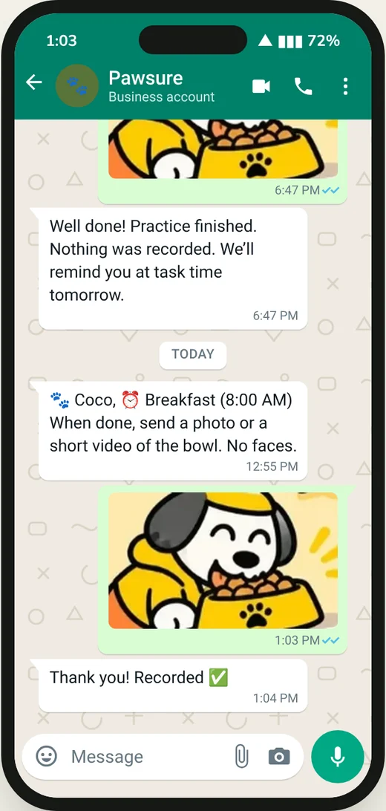
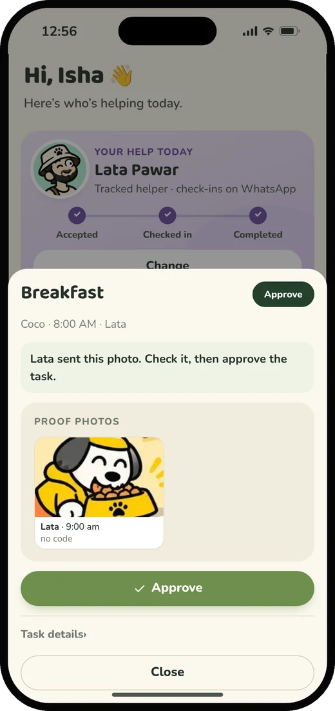
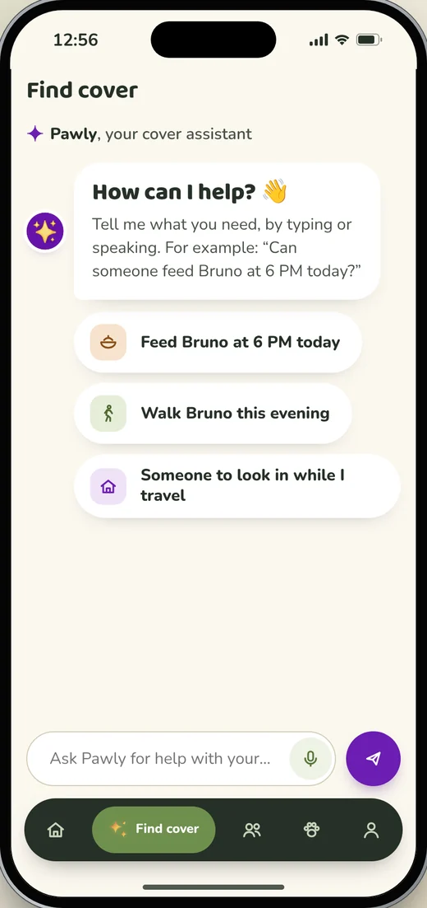
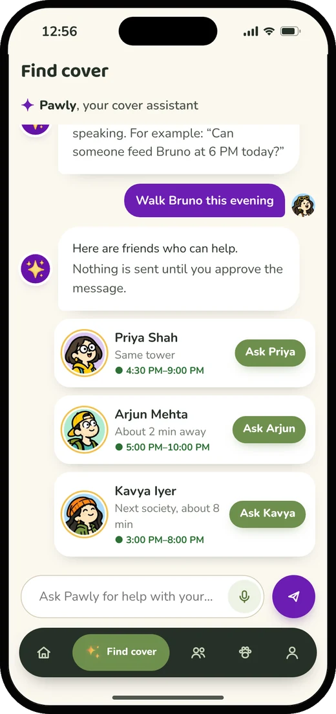
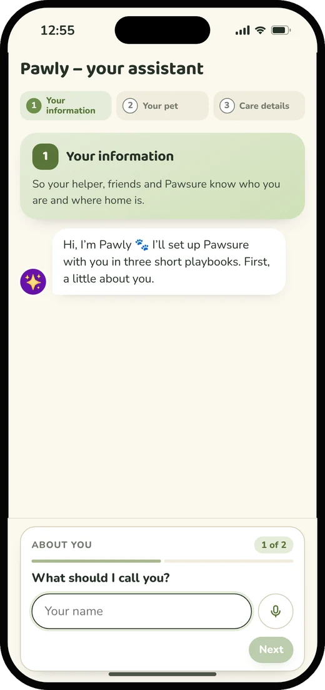
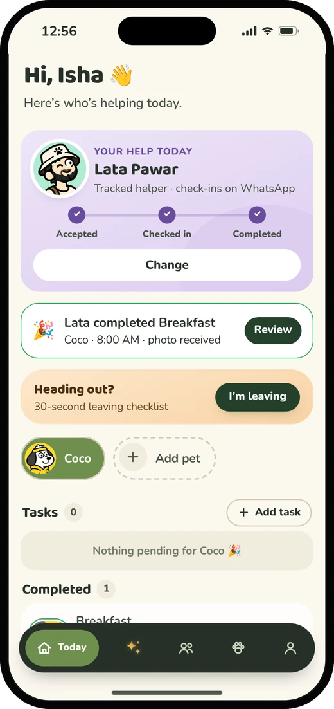
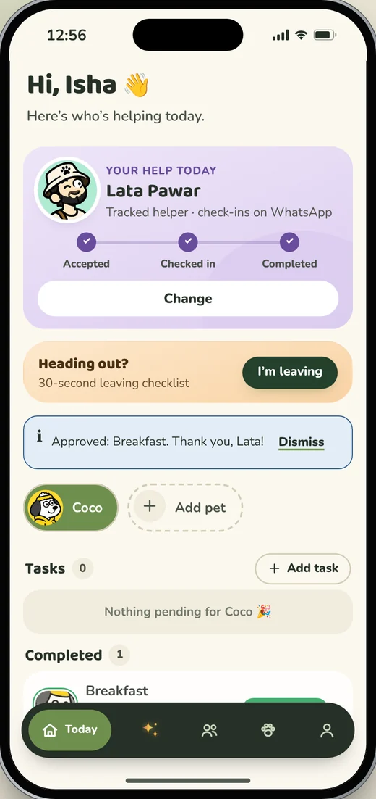

# 1:07 PM. Do you know if your dog has eaten?

*How we designed Pawsure: proof of pet care at home, built around a helper who never wanted another app.*

Team: Group-G, IITR · Research, product, design and a working demo · Mobile app + WhatsApp · Pilot planned in Mumbai, Andheri–Powai

---

It’s 1:07 PM. Neha is between meetings. She sends her helper a message.

> **Did Bruno eat? 🙏** · 1:07 PM
> **And water bowl?** · 1:19 PM
> **Sunita??** · 1:42 PM
> *haan didi sab done 👍* · 2:58 PM

“All done.” Done when? Done what?

In our survey, 62% of pet parents rely on someone else to check on their pet, and 16% came home to find something wrong. This is the story of how we designed **Pawsure**, a way to know whether planned care actually happened.

## Care at home is a guess

Neha works 8 to 10 hours a day. Her helper, Sunita, comes in at lunch to feed Bruno, refill his water and take him down for a short walk. Most days it all happens. Some days it doesn’t, and Neha finds out at 7 PM, from an empty bowl.

Nothing in that arrangement is broken, exactly. There is a plan, but it lives in Neha’s head and in a dozen old WhatsApp messages. There is a helper, but no signal when she misses a visit. And there is no backup when she can’t come, because nobody planned for that day.

**Three gaps, every working day: no shared plan, no signal, no backup.**

## Everyone is improvising

We started with a survey and interviews with pet parents, mostly working professionals in Mumbai. The sample is small and exploratory (n = 45), but the pattern was hard to miss: people were already building their own monitoring systems out of phone calls, cameras and favours.

- **80%** leave their pet alone at least sometimes (36 of 45)
- **69%** have changed their plans because of their pet (31 of 45)
- **62%** rely on someone else to check on their pet (28 of 45)
- **42%** use a pet camera (19 of 45). It can watch. It can’t refill a bowl.
- **40%** have paid for pet care (18 of 45)
- **16%** came home to find something wrong (7 of 45)

## The person we almost designed out

Our first sketches were owner apps: dashboards, alerts, a live status. Then we spent time with the people actually doing the care.

Sunita works across three flats. She uses WhatsApp and voice notes, in Hindi or Marathi, sometimes on a basic phone. She has no interest in installing anything, and a very reasonable fear of being blamed for honest mistakes.

That changed the brief. If proof of care needed Sunita to adopt an app, Pawsure would fail on day one. So the product had to work for two people with opposite worries:

- **Neha, 34, the owner.** *“Is Bruno okay?”* She can’t tell if lunch, water and the walk actually happened. She needs one honest status for the day, and alerts only when something slips.
- **Sunita, 45, the helper.** *“Will I be blamed?”* She dislikes apps, typing, being watched, and blame for honest mistakes. She needs a simple request in her language, no app, fair credit, and the right to stop any time.

## Everyone solves a slice

Pet care apps help you book someone. Cameras help you watch. Friends help, informally, until they can’t. None of them answer Neha’s actual question, which is whether the care she planned happened today.

- **Care marketplaces** (PetBacker, ThePetNest): help you book. No proof, no backup.
- **Sitting and boarding** (Rover, Wag!, TrustedHousesitters, PawSpace): help you book. No proof, no backup.
- **Pet cameras** (Furbo, Petcube): let you watch. They can’t act.
- **Friends and helpers**: no shared plan, no proof, no fallback.
- **Pawsure**: proof that care happened, and a backup when it doesn’t.

> Others help you book care. **Pawsure assures it happened**, and has a backup when it doesn’t.

## Five design bets

Each of these could have gone the other way. Here is what we chose, and what it cost.

### 1. WhatsApp, not an app

The owner invites the helper from sign-up. Sunita gets a WhatsApp message in her language, sends a photo of her ID, and joins with one tap. From then on, Pawsure reminds her when each task is due, right where she already talks to everyone. Basic phones check in with a free missed call.

*What it cost:* less control. We design inside someone else’s chat, with templates and buttons instead of a custom interface.

### 2. “Likely” is a feature

A phone call proves someone came. It doesn’t prove Bruno was fed. So Pawsure records the visit and each task separately, and shows how sure it is:

- **Confirmed**: two independent signals, like a photo with the day’s code plus arrival and exit calls.
- **Likely**: one task signal, such as a photo, a voice note naming the task, or a code after the prompt.
- **Not confirmed**: nothing, or contradictory evidence. Never called a failure.

*What it cost:* a more complicated status than a green tick. Owners have to learn three words instead of one.

### 3. The bowl, never the face

Sunita sends a photo of the bowl, or a short video. Never a selfie. The photo lands on the task in the owner’s Home, which changes from *Pending* to *Approve*. The owner opens it, sees the same photo, and approves in one tap.

*What it cost:* a bowl photo can be faked. We raise the effort with fresh codes and random photo requests, and we say plainly that this reduces fakes rather than eliminating them.

### 4. Cover before crisis

Owners type what they need in plain words to Pawly, the AI assistant. Pawly finds their own friends nearby who are free and comfortable with the task, nearest first, and drafts the WhatsApp message. Nothing is sent until the owner approves it.

*What it cost:* a smaller pool than a marketplace. New-to-the-city owners may have nobody to ask yet, so sign-up helps them build a circle in their own society.

### 5. Sign-up is a conversation

Instead of a form, sign-up is a short chat with Pawly, your personal AI assistant. Your name, your home, your pet, what they eat and when. Each care answer becomes one of today’s tasks, and the last question invites your helper. By the end of the chat, the day is already planned.

*What it cost:* chats feel slower to skim than forms. We kept every question short and made most answers one tap.

## The best feature was deleting things

Every review round with our product owner ended the same way: something came off the screen. We tracked the cuts, because the list explains the product better than the feature list does.

**9 fields removed from sign-up** across our reviews: address, flat, breed, sex, allergies, medicines, vet name, vet phone and age.

- ~~Your home form~~: the phone’s location suggests the society instead.
- ~~Breed and sex~~: nice to know, not needed to feed Bruno today.
- ~~Health and vet details~~: moved out of sign-up, to fill in later.
- ~~How old is Bruno?~~: removed after the last review.
- ~~The food-box code card~~: a photo or a short video is all the helper sends now.
- ~~“My help can’t come” on Home~~: the helper can say it herself on WhatsApp.
- ~~SOS and requests on Home~~: moved to the Me tab. Home shows only today.
- ~~Status notes beside her phone~~: the Home card already shows what changed.

## The first day, end to end

This is the path we tested hardest, because it’s the moment the product earns trust: the first time a task happens and the owner can see it.

1. **Owner:** a short chat with Pawly sets up the home, the pet and the routine.
2. **Helper:** Sunita gets an invite on WhatsApp and joins with photos.
3. **Helper:** at task time, Pawsure reminds her what to do.
4. **Owner:** her bowl photo appears on Home, waiting for review.
5. **Owner:** one tap to approve. Breakfast moves to Completed.

## Let the helpers sell it

*Our go-to-market proposal. These plays haven’t been tested yet.*

The most interesting thing about Sunita is that she works in three homes. Every helper who joins Pawsure already walks into two more flats with pet owners in them. So instead of buying owners one by one, we plan to grow through the people who do the care.

- **One helper, three homes.** Every helper we onboard brings Pawsure into the next flat she works in. Her check-ins are the demo.
- **One society at a time.** A care-circle invite in the residents’ WhatsApp group, a QR code in every lift, and a Sunday paw parade where dogs, owners and helpers meet.
- **Proof, made for WhatsApp status.** A weekly care card owners want to post, such as “Bruno’s week: 31 of 31 tasks covered”. Every post is an invite.
- **Offices and vets.** A pet-parent perk with offices in Powai, where our owners spend their hours away, and an emergency card handed out at partner vets.

## How we’ll know

Our north star is **covered care days** per household per month: days when every planned task was Confirmed, Likely, matched by the owner’s return check, or escalated and handled. The pilot starts with 20 homes in one Mumbai cluster for four weeks, with these targets:

- **80%** of care days covered
- **under 30 seconds** median time for a helper to check in
- **70%** of helpers check in within 3 days of joining
- **5% or fewer** false confirmations
- **50%** of Friend Finder requests fulfilled
- **50%** of homes still active in week 4

## Four things we’d tell the next team

1. **Find the second user early.** Our first sketches were owner apps. The product only made sense once we designed for the helper, who has every reason to say no.
2. **Honesty is a design material.** Saying “Likely” instead of “Done” looks weaker on paper. It is also the only status an owner can safely rely on.
3. **Meet people in the app they already use.** WhatsApp limited what we could build, and that limit is exactly why a helper on a basic phone can take part.
4. **Cut until it hurts, then cut once more.** Nine sign-up fields disappeared across our reviews, and none of them came back.

---

**Pawsure** · Be sure, whoever’s caring

Group-G, IITR: Apurva, Nikita, Neha, Rakesh, Sukanta, Tanvi, Vibhor, Yasin

*Personas and names in this study are illustrative. Survey: n = 45, exploratory.*
