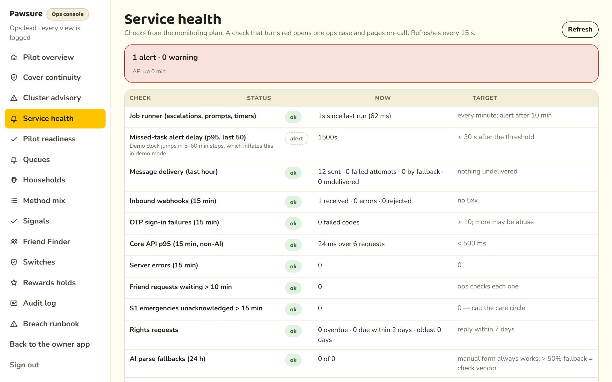
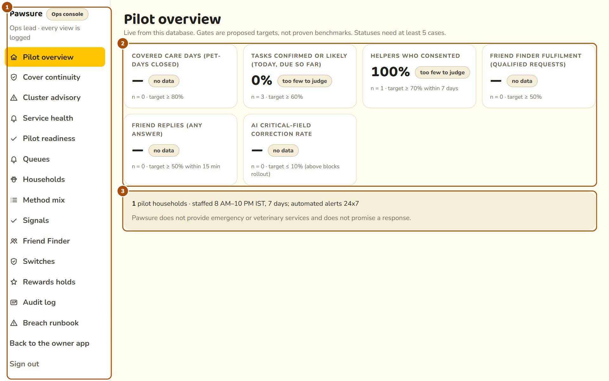
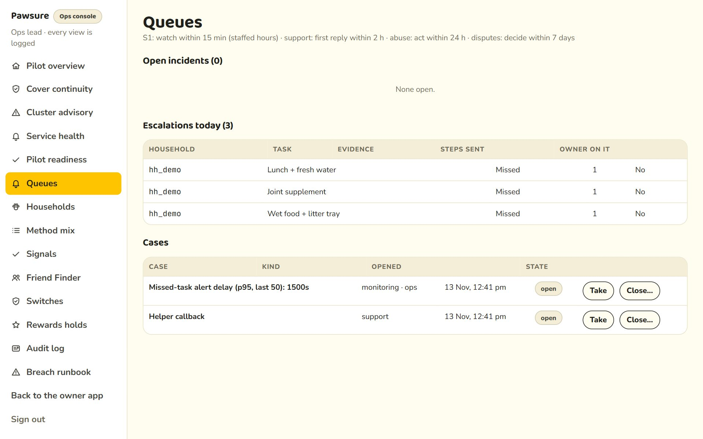
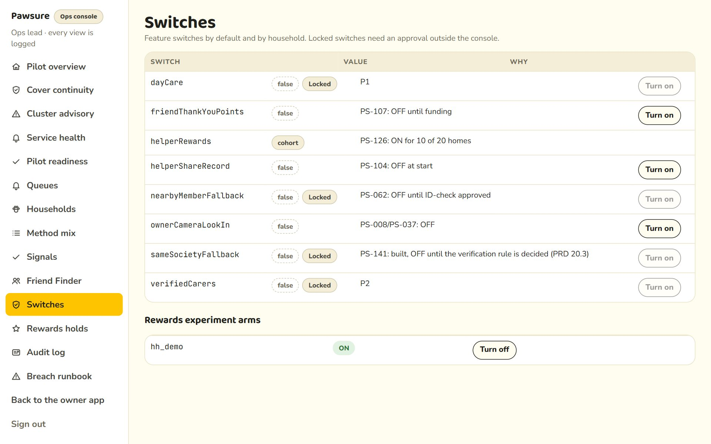
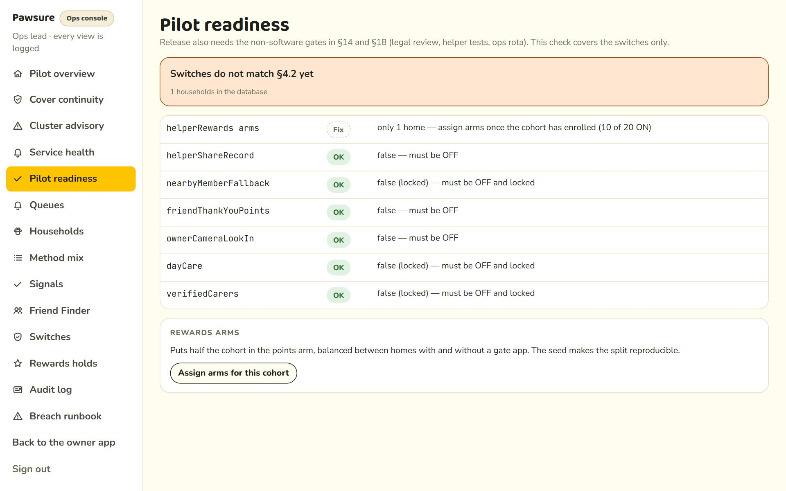
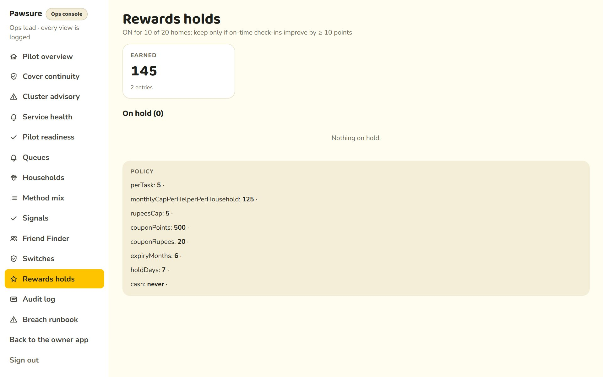
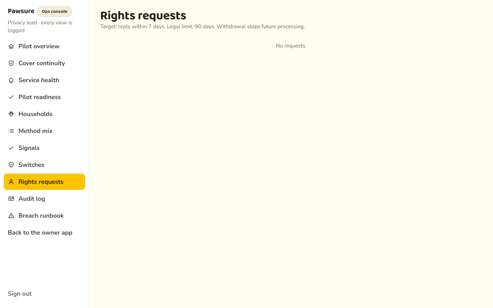
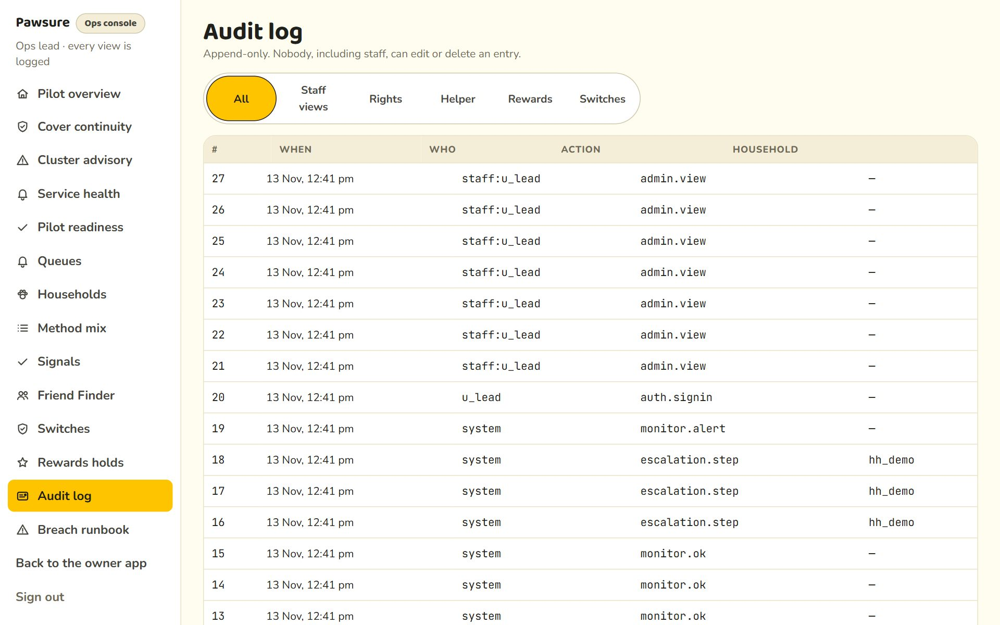
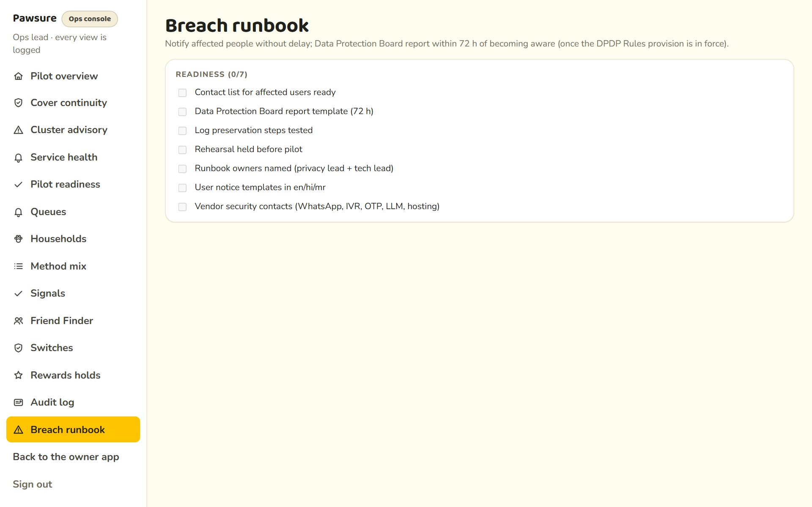

# Installation and Administration Guide

## 1 About this guide

This guide covers installing Pawsure on a developer machine, configuring it, deploying it for staging or the pilot, and running it day to day: the job runner, backups, retention, monitoring, staff roles and the operations console.

> [!IMPORTANT]
> **Before the pilot**
>
> No vendor is connected in this release: SMS, WhatsApp, IVR, push, AI and object storage are mock adapters that record what would be sent. No staging or pilot environment exists yet. The go / no-go checklist is in `docs/runbooks/pilot-runbook.md`.

### 1.1 Components

| Component | Folder | What it is |
|---|---|---|
| Owner app (PWA) | `apps/web` | React + Vite progressive web app for owners, care circle, helpers and friends, plus the operations console at `/admin`. |
| API | `apps/api` | Hono on Node.js: authentication, households, daily care, helper channel, Friend Finder, console, jobs, webhooks. |
| Rules | `packages/domain` | Pure business rules: evidence labels, escalation, covered day, emergencies, rewards, permissions, Friend Finder. |
| Database | `packages/db` | SQL migrations and the client: PGlite (embedded PostgreSQL) locally, PostgreSQL in production. |
| Tests and tools | `e2e`, `apps/api/test`, `tools` | Playwright end-to-end tests, API tests, load test, backup and restore drill, document generators. |

### 1.2 Requirements

| Item | Requirement |
|---|---|
| Node.js | 20 or later (tested on 24) |
| npm | 10 or later |
| Database (production) | Managed PostgreSQL 15+ in an India region, with point-in-time recovery |
| Browser (users) | Recent Chrome, Edge, Safari or Firefox; iOS 16.4+ for home-screen install and push |
| End-to-end tests | Google Chrome installed (Playwright uses it) |

## 2 Installing on a developer machine

No Docker or database server is needed: local data lives in `apps/api/.data/pglite`.

```bash
git clone https://github.com/yasin679/Pawsure.git
cd Pawsure
npm install
```

Start the API and the app in two terminals:

```bash
npm run dev:api
```

```bash
npm run dev:web
```

Open `http://localhost:5173`. In demo mode the sign-in code is shown on screen. The operations console is at `http://localhost:5173/admin`.

> [!TIP]
> To start again with fresh demo data, stop the API and delete `apps/api/.data/pglite`.

### 2.1 Checking the installation

```bash
npm run typecheck
npm test
npm run e2e
```

`npm test` runs the API, rules and database tests (211). `npm run e2e` builds and serves the demo (unless it is already running on port 4174) and runs the 90 end-to-end browser tests in Chrome.

## 3 Configuration

Settings are environment variables on the host. The API does not read a `.env` file by itself; `.env.example` lists every setting. Locally you can run with `node --env-file=.env`.

| Variable | Required | Meaning |
|---|---|---|
| `NODE_ENV` | Yes | `production` on staging and the pilot. |
| `PORT` | No | API port (default 8787). |
| `DATABASE_URL` | Production | PostgreSQL connection string. Leave unset for local PGlite. |
| `PGLITE_DIR` | No | Local data folder (default `.data/pglite`). |
| `DEMO_MODE` | No | `1` (default in development) turns on the demo clock, on-screen codes and `/demo` routes. Must be `0` on the pilot. |
| `DEMO_START` | No | Demo clock start time. |
| `OTP_PEPPER` | Outside demo | Long random secret used to hash sign-in codes. The API refuses to start without it. |
| `CODE_CARD_KEY` | Production | 32 random bytes, base64. Encrypts code-card codes. |
| `JOB_SECRET` | Outside demo | Sent by the scheduler as `x-job-secret`. Without it the job runner refuses to run. |
| `WEBHOOK_SECRET` | Outside demo | Sent by every vendor webhook as `x-webhook-secret`. Without it, webhooks are refused. |
| `WEB_ORIGIN` | Production | Comma-separated origins allowed to call the API (CORS). |
| `BACKUP_DIR`, `BACKUP_KEY` | PGlite only | Nightly encrypted backups (32 bytes, 64 hex characters). |
| Vendor keys | When contracted | `SMS_*`, `WA_*`, `IVR_*`, `VAPID_*`, `LLM_API_KEY`, `STORAGE_*` (see `docs/runbooks/vendors.md`). |

The app reads one setting at build time: `VITE_API_URL`, the API address.

Generate secrets with:

```bash
node -e "console.log(require('crypto').randomBytes(32).toString('base64'))"
```

> [!CAUTION]
> Never set `DEMO_MODE=1` on a database with real people: it seeds demo data and returns sign-in codes in responses. Keep every secret in the host’s secrets manager, never in Git.

## 4 Deploying staging or the pilot

The full procedure, with rollback, is in `docs/runbooks/deployment.md`. In short:

1. `npm ci && npm run typecheck && npm test` pass on the commit.
2. Build the app: `npm run build` (static files in `apps/web/dist`, served over HTTPS).
3. Take a database snapshot.
4. Start the API. Migrations run at start-up in order, each in a transaction. They only add tables and columns, so the previous version still runs against the new schema.
5. Check `GET /ready`, sign in, open **Console → Service health**.
6. Turn on the scheduler: every minute, `POST /jobs/tick` with `x-job-secret`.

### 4.1 The shareable demo

`npm run build:demo -w @pawsure/web` builds a version where the API and database run inside the visitor’s browser (static files in `apps/web/dist-demo`). It needs no server and is published as a Claude artifact. Each visitor gets a fresh copy; nothing is sent anywhere. It is for showing the product, never for real data.

## 5 Running Pawsure

### 5.1 The job runner

`POST /jobs/tick` runs every minute. Each run is idempotent: it sends cover reminders (90 min before a visit, or 8 PM the evening before), marks tasks at risk, runs the backup list, the Friend Finder cutoff, holds and auto-confirms, cover-not-found calls and the 15-minute care-circle call, gate-and-key reminders, the weekly thin-circle check and advisories; it sends helper prompts 10 minutes before tasks, fires escalation steps, runs incident call plans, health reminders and Friend Finder timers, closes the day at 11:59 PM, makes each month’s code card, sends the Sunday points message, runs retention once a day, takes the nightly backup (PGlite), and evaluates the service checks. A late run catches up without sending anything twice.

### 5.2 Backups and restore

| Deployment | How | RPO / RTO (proposed) |
|---|---|---|
| Managed PostgreSQL | Provider point-in-time recovery plus a nightly encrypted dump | 5 min / 1 h |
| PGlite on one host | Nightly encrypted snapshot (`BACKUP_DIR`, `BACKUP_KEY`) or `POST /jobs/backup` | 24 h / 30 min |

Run the restore drill weekly during the pilot, with `BACKUP_DIR` and `BACKUP_KEY` set:

```bash
npm run restore-drill
```

It restores the newest backup into a throwaway database, compares every table’s row count with the manifest, checks the audit log is still append-only, and writes `docs/runbooks/last-restore-drill.md`. Details: `docs/runbooks/restore.md`.

### 5.3 Retention

Retention runs once a day:

| Data | Kept for |
|---|---|
| Photos and voice notes | 90 days (kept while a dispute is open; the image fingerprint is kept so reused photos are still caught) |
| Friend request text and AI output | 90 days |
| Live visit location | 24 hours after the visit |
| Friend profile after opting out | 30 days |
| Message metadata | 12 months |
| Sign-in codes | 24 hours |
| Incidents | 3 years |

### 5.4 Monitoring

**Console → Service health** shows 13 checks: job runner, alert delay, message delivery, webhooks, sign-in failures, API speed, server errors, stuck friend requests, unacknowledged S1 emergencies, rights-request age, AI fallbacks, database and retention. A check that turns red opens one ops case and pages on-call. Point an uptime monitor at `GET /ready`. Thresholds and first responses: `docs/runbooks/monitoring.md`.



## 6 Staff and the operations console

### 6.1 Granting staff roles

Staff sign in with their own mobile number like everyone else. A role is granted by a database record (there is no self-service):

```sql
insert into staff_roles(user_id, role) values ('<user id>', 'ops');
```

| Role | Can open |
|---|---|
| Ops on shift (`ops`) | Overview, service health, queues, households, method mix, signals, Friend Finder. Can take and close cases. |
| Ops lead (`ops_lead`) | Everything ops can, plus switches, pilot readiness, rewards holds, audit log and the breach runbook (read). |
| Privacy lead (`privacy_lead`) | Overview, service health, pilot readiness, households, method mix, signals, switches (read), rights requests, audit log (with export), breach runbook. |
| Tech lead (`tech_lead`) | Overview, service health, pilot readiness, queues, method mix, signals, Friend Finder, switches, audit log, breach runbook. |
| Auditor (`auditor`) | Overview, service health, queues, method mix, signals, audit log (with export). |

The console keeps its own sign-in, separate from the owner app on the same device, so signing in to one never signs you out of the other. Every console view, and every refused attempt, is written to the append-only audit log. Phone numbers are always masked; photos, addresses and pet details are never shown.

### 6.2 Console sections



| # | Item | What it does |
|---|---|---|
| 1 | **Sections** | Only the sections your role allows. |
| 2 | **Pilot gates** | Covered days, Confirmed/Likely share, helper consent, Friend Finder fulfilment, friend replies and AI correction rate, each with its count (n) and target. Nothing is judged on fewer than 5 cases. |
| 3 | **Service** | Number of households, staffed hours, and the reminder that Pawsure does not provide emergency or veterinary services. |

| Section | What you do there |
|---|---|
| Queues | Open incidents, today’s escalations and cases. **Take** a case, or **Close…** it with a reason (required). |
| Households | Cohort, rewards arm, gate app, helper method, today’s status, masked owner phone. |
| Method mix | Helpers by method and language; Confirmed/Likely by method, language and gate app. Groups under 5 are hidden and no helper is named. |
| Signals | Today’s evidence labels across households and recent signal events. |
| Friend Finder | Request states, stuck requests, parsing corrections, and the AI and webhook log. |
| Switches | Feature switches by default and per household. Locked switches can’t be changed here. |
| Cover continuity | The six v1.4 metrics with the 10% cover-not-found review line, and the WhatsApp template catalogue with each template’s approval status. All roles. |
| Cluster advisory | Ops and ops lead: choose a cluster and reason (red rain alert, strike, festival day), read the preview, send. Owners are told; helpers get tomorrow’s reminder that evening. |
| Pilot readiness | Checks the switches match the pilot plan and assigns the rewards arm to half the cohort from a recorded seed. |
| Rewards holds | Points held after a mismatch. Release or reverse within 7 days, with a reason the helper reads on WhatsApp. |
| Rights requests | See, correct, withdraw, delete and complaint requests with 7-day target and 90-day limit. Reply and close. |
| Audit log | Append-only record of every action; filter, and export CSV (auditor and privacy lead). |
| Breach runbook | Readiness checklist, rehearsals and incidents with the 72-hour Board clock. |





### 6.3 Pilot switches

| Switch | Pilot setting |
|---|---|
| `helperRewards` | On for 10 of 20 homes (assigned in Pilot readiness) |
| `helperShareRecord` | Off at start; may be turned on after week 2 |
| `nearbyMemberFallback` | Off and locked until identity checks are approved |
| `sameSocietyFallback` | Off and locked until the verification rule is decided (PS-141) |
| `friendThankYouPoints` | Off until funding is approved |
| `ownerCameraLookIn` | Off |
| `dayCare`, `verifiedCarers` | Off and locked (later releases) |



### 6.4 Rewards holds, rights requests and the audit log







### 6.5 Breach runbook



Start a rehearsal before the pilot and keep the seven readiness items ticked. For a real incident, the console shows the hours left until the Data Protection Board report is due (72 hours from becoming aware), and the steps to tick: affected people notified, Board report filed, closed.

## 7 Security settings

| Control | Setting |
|---|---|
| Sign-in | 6-digit SMS code, 5-minute expiry, 5 tries, 30-second resend gap, 3 codes per 15 minutes; same response whether or not the number exists |
| Sessions | 256-bit random tokens stored hashed, 30-day expiry; sign-out ends the session on the server; sign out of all devices |
| Access | Every request checked against the role and household on the server |
| Webhooks and jobs | Shared secrets, refused when not configured |
| Requests | 64 KB size limit; 10 cover requests per household per hour; 20 friend invites per day |
| Headers | `X-Content-Type-Options: nosniff`, `X-Frame-Options: SAMEORIGIN`, `Referrer-Policy: no-referrer` |
| Audit log | Append-only (database trigger), survives backup and restore |

## 8 Upgrading and rolling back

**1.0.1 → 1.1.0:** deploy as in section 4. Migration `006_cover_continuity.sql` runs at start-up and only adds tables and columns, so an app-only rollback to 1.0.1 is safe (the new tables are ignored). To remove the 1.1.0 data as well, take a backup and run `packages/db/rollback/006_cover_continuity.down.sql` by hand, in one transaction. Per-household cover timings can be set in `households.cover_config` (JSON, for example `{"reminderLeadMin": 120}`); unknown keys and negative numbers are ignored.


Deploy the new version as in section 4. Because migrations only add, an app-only rollback is safe: redeploy the previous build. For a bad migration or data problem, restore the pre-deploy snapshot and redeploy the previous build; vendors re-send events on retry and duplicate events are ignored.

## 9 Reference documents

| Document | Where |
|---|---|
| API reference (generated, 112 routes) | `docs/api.md` |
| Permission matrix (generated) | `docs/permission-matrix.md` |
| Requirements traceability (generated) | `docs/traceability.md` |
| Decision log | `docs/decision-log.md` |
| Runbooks: pilot, monitoring, support, deployment, restore, vendors, drills | `docs/runbooks/` |
| Known limitations | `docs/known-limitations.md` |
