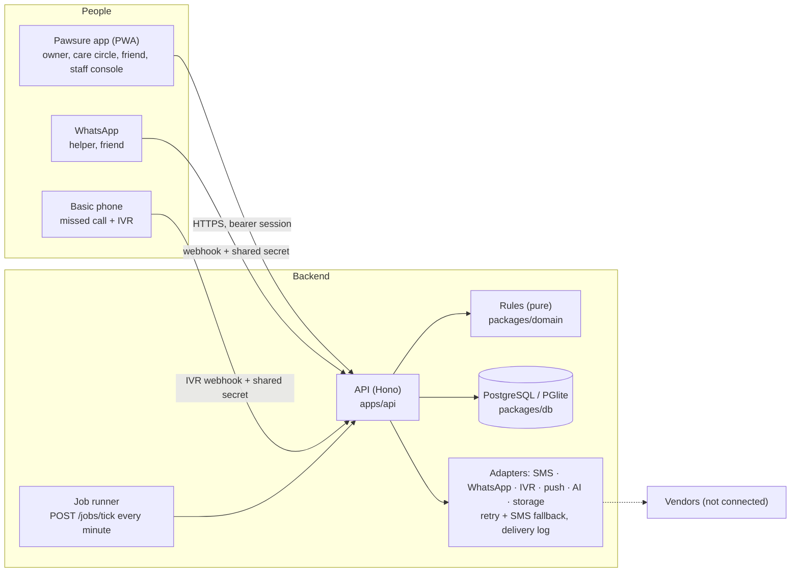
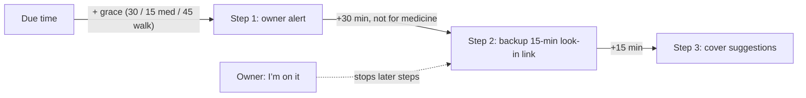
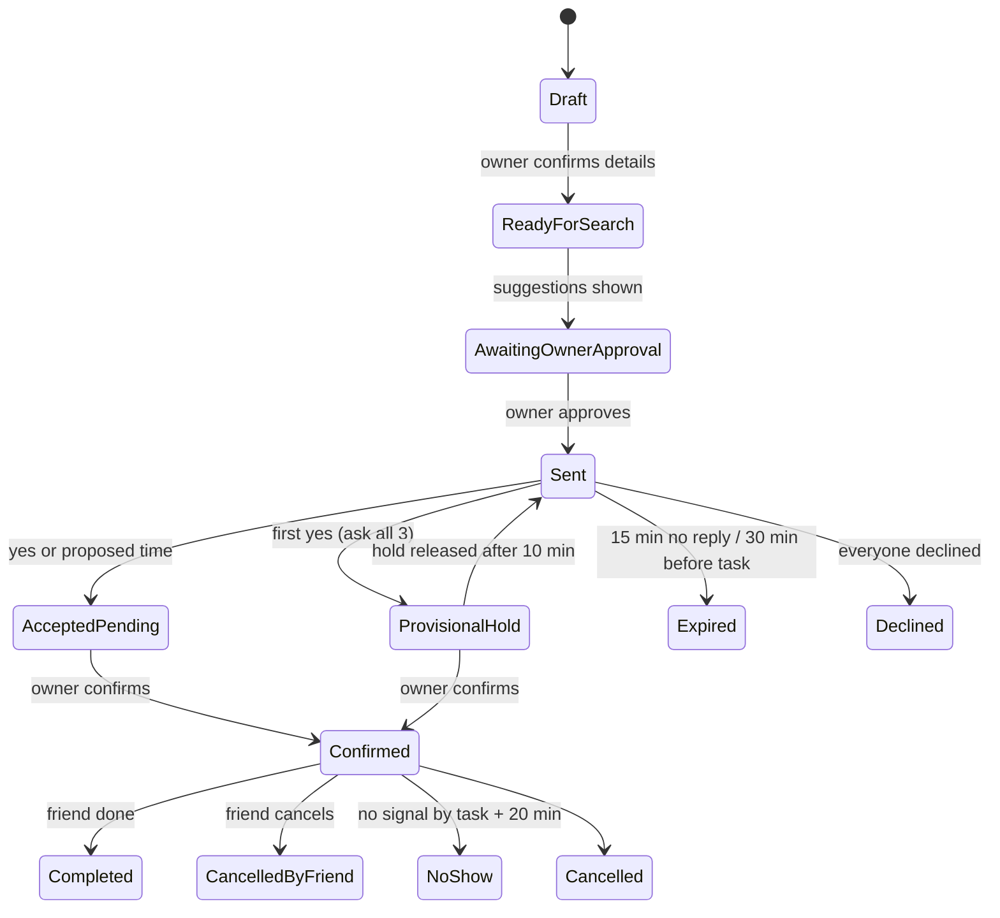
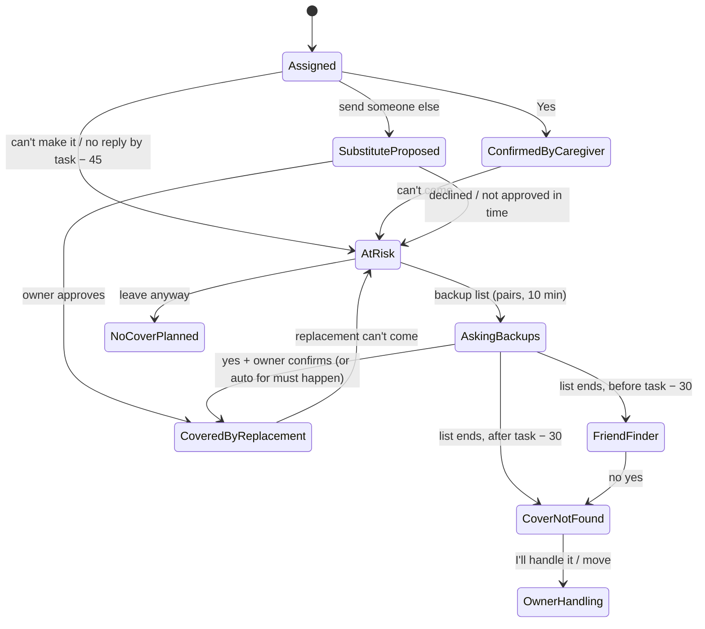
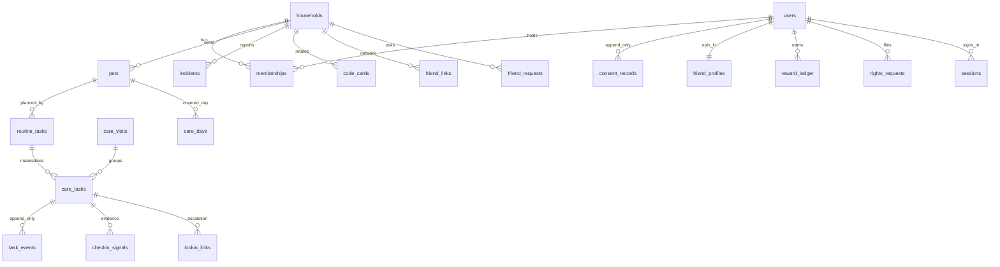

# Technical Design

## 1 Overview

Pawsure P0 is an installable progressive web app (PWA) backed by an API and a PostgreSQL database. It is built from PRD v1.3 and Master Prompt 2 (P0 mobile application). Helpers and friends use WhatsApp or a basic phone; owners, their care circle and the operations team use the app.

### 1.1 Design principles

| Principle | How it shows in the design |
|---|---|
| Honest evidence | A deterministic, versioned rule set (`confidence-v1`) turns signals into labels with reason codes. A visit never confirms a task by itself. |
| Consent first | No helper signal is stored before consent; withdrawal stops future collection at once. |
| Least disclosure | Friends see society and tower; flat, key and emergency card only after owner confirmation, for one visit. Staff never see raw phones, media or addresses. |
| Business rules outside the UI | All rules live in `packages/domain`, pure TypeScript with no I/O, shared by API, jobs and app. |
| Idempotent everything | Webhooks, jobs, notifications and evidence carry unique keys; replays never double-count or double-send. |
| Append-only history | Audit log, task events and consent records reject updates and deletes in the database. |
| Vendors behind adapters | SMS, WhatsApp, IVR, push, AI and storage sit behind interfaces with mocks until contracts exist. |

## 2 Architecture

| Layer | Implementation | Pilot target (decision D-01, open) |
|---|---|---|
| App | React 18 + Vite 5 PWA (`vite-plugin-pwa`, service worker, offline banner); same CSS tokens as the prototype | Static hosting on a CDN in an India region |
| API | Hono 4 on Node (`@hono/node-server` 2.1); zod 4 validation on every body | Node service or serverless functions |
| Rules | `@pawsure/domain` (TypeScript, no I/O) | Same |
| Database | PostgreSQL schema; PGlite locally and in the shareable demo | Managed PostgreSQL, India region, encrypted, PITR |
| Jobs | One idempotent `POST /jobs/tick` | Scheduler every minute with `x-job-secret` |
| Shareable demo | The API and PGlite compiled into the page (`apps/web/src/demo`), Node crypto replaced by `@noble` libraries | Demo only (D-36) |

### 2.1 Repository layout

| Path | Contents |
|---|---|
| `packages/domain/src` | `trust.ts` (evidence), `escalation.ts`, `coveredDay.ts`, `emergency.ts`, `lifecycle.ts`, `rewards.ts`, `ledger.ts`, `codeCard.ts`, `permissions.ts`, `daily.ts`, `pilot.ts`, `friendfinder/` (parse, match, state machine) |
| `packages/db` | `migrations/001–010`, rollbacks, client (`index.ts`), demo seed, encrypted backup and restore verification |
| `apps/api/src` | `app.ts` (auth, households, pets, today), `daily.ts` (daily care, helper channel, code cards, look-in, incidents, health, circle, jobs), `friends.ts` (Friend Finder), `admin.ts` (console, rights, wallet, share record), `ops.ts` (retention, monitoring, backups), `delivery.ts` (failover), `adapters.ts`, `templates.ts` |
| `apps/web/src` | `App.tsx` (shell and routing), `screens/` (Today, Pet, CareSetup, FindCover, Friends, FriendHome, Account, RoleHomes, Admin, LookIn, simulators) |
| `e2e`, `apps/api/test`, `packages/*/test` | Playwright end-to-end tests; API, rules and database tests |

## 3 Core rules

### 3.1 Evidence (rule set `confidence-v1`)

| Signal | Alone gives |
|---|---|
| Photo with today’s code (checked on the server) | Likely |
| Photo without code; voice note naming the task; IVR code after a prompt | Likely |
| Arrival and exit calls from the registered number | Visit evidence only |
| Wrong or old code; reused image (same fingerprint) | Not confirmed / not counted |
| Two independent channels (for example photo + code and sufficient arrival/exit calls, or photo + owner-provided gate entry) | Confirmed |

**Visit codes (D-52, D-53).** After a registered arrival call, and again after the exit call, the API sends the helper a random 3-digit code (`care_visits.start_code_sealed` / `end_code_sealed`, sealed like the code card; the send time in `start_code_at` / `end_code_at`). A photo replying with the code is stored as a `code_start` or `code_end` signal with `code_ok`. `evaluateVisit` grades each code `ok` (right code within `visitCodeWithin` = 10 min), `late`, `wrong`, `waiting` or `missing`, ignoring re-sent images and anything sent before the code. Long-enough calls with both codes `ok` make the visit *Confirmed*; a `wrong` code makes it *Not confirmed* unless an owner-provided gate entry exists; codes never change a task's label directly. Reason codes: `R-START-CODE-*`, `R-END-CODE-*`.

Grace periods: standard 30 minutes, medicine 15, walk 45. Evidence up to 3 hours late is kept and marked late. A visit shorter than the summed task minimums (capped at 30 minutes) does not count; an arrival without exit is *in progress* for 45 minutes. Random photo checks are requested on 1 in 5 tasks without a gate app (or after a mismatch in 14 days), otherwise 1 in 10, chosen with a server secret.

### 3.2 Escalation

Only an explicit acknowledgement stops later steps. A friend no-show (no signal by task time + 20 minutes) forces the backup step, or cover suggestions for medicine.

### 3.3 Covered day (`covered-day-v1.4`)

A pet’s day is covered when every non-cancelled task is Confirmed, Likely or Matched, or missed but escalated and resolved before midnight. The household is covered when every pet is. In Trusted Helper mode, the owner’s **Covered** tap decides; no tap means *Unknown*. Results are stored at 11:59 PM with the rule version as part of the key, so a new rule never rewrites old days.

v1.4 adds one rule: a task whose cover ended as **No cover planned** or **Cover not found** (or was skipped after cover not found) is not covered unless it is later done with evidence or matched by the return check. A resolved escalation does not rescue it. The rule version is stored with each day.

### 3.4 Emergencies

| Severity | Categories | Plan |
|---|---|---|
| S1 urgent | Pet hurt, bite, collapse/breathing, pet missing, door/key | Owner + backup at once by WhatsApp and call; repeat calls every 5 min ×3; at 15 min whole circle; ops case at once |
| S2 unwell | Vomiting, not eating, limping, unusual behaviour | Owner; backup +15; calls and ops review +30 |
| S3 practical | Food, water or pads ran out; pet outside | Owner; backup +30 |

### 3.5 Friend Finder

Parsing returns a structured result (tasks, pet, time, duration, access, urgency, medicine instructions, sources, clarifications). The AI adapter is a mock that reports `connected: false`; requests are parsed by the rules parser and labelled *understood by rules (no AI connected)*. A real model would have an 8-second timeout and fall back to rules or the simple form. Matching is deterministic: filters (opted in, not paused or blocked, free, capability including medicine, key, stairs), then ranking by distance band, then reply history. Exclusions are reported as counts only. On confirmation, a time-limited access grant (2 hours after the task) is created and only same-pet, same-kind helper tasks are reassigned.

### 3.6 Rewards

5 points per Confirmed or Likely helper task, capped at 125 per helper per household per month (₹5); 500 points = ₹20 coupon; expiry 6 months; mismatches put points on hold for a human decision within 7 days with a reason the helper reads. Points accrue live and are written to the ledger at day close, once per task (unique index). The arm is on for half the cohort, assigned by stratified shuffle from a recorded seed.

### 3.7 Cover continuity (v1.4, rule `cover-v1.4`)

Cover (who is expected to do a task) is tracked separately from evidence (whether it was done). The rules are pure functions in `packages/domain/src/cover/`; `apps/api/src/cover.ts` persists state and runs them on the minute job.

| Module | Rule |
|---|---|
| `config.ts` | All timings with the PRD defaults (`COVER_V1`), overridable per household and per task (`coverConfig`); urgency defaults; Friend Finder gate; cover-not-found options; the 15-minute care-circle call |
| `stateMachine.ts` | `coverTransition(from, event, guards)` with reason codes; guards for the Friend Finder cutoff and urgency; property tests check every state has a next step and can reach a settled state |
| `planner.ts` | `planReminder` (90 min / 8 PM the evening before / advisory), `atRiskReason`, `orderBackups` and `nextBackupAction` (pairs, hold, auto-confirm, exhausted), `preDepartureCheck`, `planDelay` / `splitExtension`, `thinCircle`, `checklistReminderDue`, `isCantCome` (en/hi/mr), `parseSubstitute`, `coverMetrics` |
| `permissions.ts` | Roles `substitute` and `adhoc_visitor` (task-scoped one-time link; details only after acceptance and owner approval); `outreachAllowed` limits standing approval to the backup list |

One at-risk **job** per visit holds who was asked, when, replies, the hold and a log (`cover_jobs`). The job applies one domain action at a time until the runner says *wait*, so every run of the minute job is idempotent. After cover continuity has run for a task, the missed-task ladder still alerts the owner but does not repeat the backup and cover steps (PRD 10.4).

## 4 Data model

| Migration | Adds |
|---|---|
| `001_init.sql` | Users, sessions, OTP, consents, households, memberships, pets, routine, care tasks and visits, task events, signals, code cards, look-in links, incidents, notifications, health, friends, requests, rewards, rights, flags, ops cases, jobs, audit log, append-only triggers |
| `002_daily_care.sql` | Day states, helper messages, helper method/pause/language, mismatch cases |
| `003_friend_finder.sql` | Friend messages, cover-task fields, access grants, live location sessions |
| `004_ops_rights_rewards.sql` | Staff roles, cohorts, ledger decisions, share links, rights fields, breach checklist and events |
| `005_pilot_readiness.sql` | Delivery log, service checks, retention runs |
| `006_cover_continuity.sql` | Cover rows, cover jobs, backups list, reminders, holds, advisories, urgency (rollback in `packages/db/rollback/`) |
| `007_qa_consolidated.sql` | Friend capacity and species, society list (name + city), the home's city, state and society id |
| `008_languages.sql` | All 22 scheduled languages for owners, helpers and friends |
| `009_proof_photos.sql` | `evidence_photos`: proof from the app (small photo, code result, who sent it), deleted after 90 days |
| `009_society_location.sql` | Society positions, so sign-up can suggest a nearby society (the phone's location is not stored) |
| `010_pet_sex.sql` | A pet's sex (him/her in friend messages) |
| `010_visit_codes.sql` | Sealed start and end codes and their send times on `care_visits`; `code_start` and `code_end` signal kinds |

Two numbers are used twice because the work was built on separate branches. Migrations are tracked by full file name and run in name order, so they must not be renamed.

Schema rules: every household-owned row has `household_id`; event and received times are stored separately and care days are IST dates; `audit_log`, `task_events` and `consent_records` reject UPDATE and DELETE; idempotency keys are unique (`checkin_signals.idempotency_key`, `notifications.dedupe_key`, `inbound_messages.message_id`); migrations only add (expand-only).

## 5 Interfaces

The API reference with all 112 routes is generated from the route table into `docs/api.md`. Groups:

| Group | Examples |
|---|---|
| Auth | `POST /auth/otp/request`, `/auth/otp/verify`, `/v1/auth/logout`, `/v1/auth/logout-all` |
| Household | `/v1/households/:hh/today`, `/pets`, `/routine`, `/day/*`, `/tasks/:id/*`, `/incidents`, `/health`, `/helpers`, `/circle`, `/code-cards` |
| Friend Finder | `/v1/households/:hh/requests…`, `/friends…`, `/v1/me/friend`, `/v1/me/requests/:id/*` |
| Me | `/v1/me`, `/v1/me/rights`, `/v1/me/export`, `/v1/households/:hh/wallet` |
| Console | `/admin/*` (staff roles only, every view audited) |
| Webhooks | `/webhooks/whatsapp`, `/webhooks/ivr` (shared secret, idempotent) |
| Jobs | `/jobs/tick`, `/jobs/backup` (job secret) |
| Links | `/l/:token` (look-in), `/r/:token` (helper share record) |
| Health | `/health`, `/ready` |

Errors are JSON `{ error, note? }`: 400 invalid input, 401 no session, 403 not allowed (logged), 404 not found, 409 invalid state or no consent, 413 too large, 429 rate limited, 503 vendor unavailable.

## 6 Security and privacy

| Area | Design |
|---|---|
| Authentication | SMS OTP: 6 digits, 5-minute expiry, 5 attempts, 30-second resend gap, 3 per 15 minutes; codes hashed with a pepper; constant-time compare; identical response for known and unknown numbers |
| Sessions | 256-bit random bearer tokens stored as SHA-256 hashes; 30-day expiry; sign-out and sign-out-everywhere revoke on the server; the app clears its cached API responses and state on sign-out |
| Authorisation | Role × resource × action matrix (`permissions.ts`, generated into `docs/permission-matrix.md`), checked on the server per household; helpers see only their own record; staff only through `/admin` |
| Data exposure | Tested per login type: no other person’s phone number or the flat number in any response; code-card codes owner-only; console phones masked; reporting cuts under 5 hidden |
| Secrets | Code-card codes AES-256-GCM encrypted; backups AES-256-GCM; job runner and webhooks require secrets and fail closed |
| Input | zod validation; 64 KB body limit; parameterised SQL (column names only from fixed lists); React escapes all text (only static icons use raw SVG) |
| Abuse | Rate limits on OTP, cover requests (10/hour/household) and invites (20/day); block and report |
| Headers | `X-Content-Type-Options`, `X-Frame-Options: SAMEORIGIN`, `Referrer-Policy: no-referrer` and related secure headers |
| Retention and rights | Daily retention job (section 5.3 of PS-IG-02); rights requests with 7-day target and 90-day limit; breach runbook with the 72-hour clock |
| Dependencies | `npm audit` of production dependencies: 0 known vulnerabilities |

## 7 Reliability and operations

| Topic | Design |
|---|---|
| Delivery | Every message retried once, then SMS fallback; attempts logged with masked recipients; OTP never fakes success |
| Monitoring | 13 service checks after each job run; a check turning red opens one ops case and pages on-call; `/ready` for uptime monitors |
| Backups | Provider PITR on managed Postgres; encrypted PGlite snapshots with a row-count manifest; weekly restore drill |
| Performance | In-process load test: p95 179 ms at pilot load (target under 500 ms); 200 homes checked for scale |
| Release | Expand-only migrations; app-only rollback is a redeploy |

## 8 Testing

| Suite | Count | What it proves |
|---|---|---|
| Rules (`packages/domain/test`) | 151 | Evidence, escalation, covered day, emergency, lifecycle, rewards, ledger, Friend Finder (with the v1.4 cutoff), cohort, cover continuity (state machine with property tests, reminders, at risk, backup runner, urgency, pre-departure, delay, permissions, metrics) |
| Database | 4 | Migrations, append-only, idempotency, multi-household helper |
| API, security, login isolation, acceptance, regressions, cover continuity, QA trackers (13 and 14 Nov, with a 7-day clock run) | 202 | Every flow end to end at the API, all 24 mandatory P0 scenarios, red-team and per-login data access |
| End-to-end browser (Playwright, Chrome) | 126 | Every screen and login type against the demo build, the 14 new v1.4 scenarios and the six demo fixes |

Results and evidence: UAT Test Cases (PS-UAT-06) and Test Evidence (PS-TE-08).

## 9 Known limitations

Vendors are mock adapters; no staging or pilot environment; no photo OCR (codes come from captions or the keypad); no live location coordinates; no coupon vendor; one job runner for all homes (shard before about 1,000); owner app in English only; developer-tool dependencies (Vitest, Vite) need major upgrades before shared CI. Full list: `docs/known-limitations.md`.
