# User Guide

## 1 About this guide

This guide walks through every screen of the Pawsure app in the order you meet them during a day of care. Each screen has a screenshot with numbered markers and a table that explains every marked item.

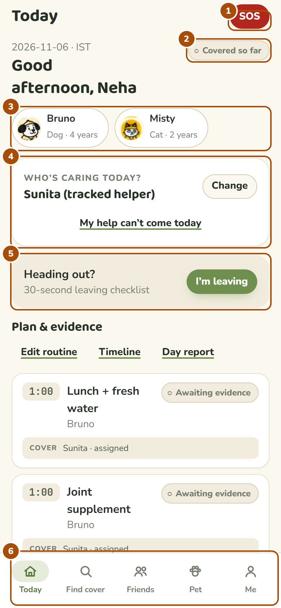

### 1.1 What Pawsure does

Pawsure helps you know your pet was cared for while you are out, whoever is doing the caring. You plan the day once. Your helper checks in on WhatsApp or with a missed call, the app shows how strong the evidence is for each task, and if a check-in is missed it tells you first, then your backup. When your usual help can’t come, Pawsure finds cover among your own friends, and nothing is sent to anyone until you approve it.

> [!IMPORTANT]
> **Three things Pawsure always does**
>
> - **Shows evidence honestly.** Each task says how strong its evidence is. A visit alone never confirms a task, and some days will be incomplete; the app says so.
> - **Asks before it shares.** Nothing is recorded about a helper until they say Yes, and nothing goes to a friend until you approve it. Your flat number and key details are shared only with a friend you have confirmed, for that visit only.
> - **Is not an emergency service.** Pawsure alerts the people you chose. In an emergency, call your vet or the 24x7 clinic on your pet’s emergency card.

### 1.2 Who should read it

| Reader | Sections to read |
|---|---|
| Pet owners and co-owners | All sections |
| Backups and family members | 2, 11 and 14 |
| Helpers | 12 (helpers mostly use WhatsApp, not the app) |
| Friends who cover | 9 and 13 |

### 1.3 How to read the screenshots

Numbered markers on a screenshot point to the item described in the matching row of the table below it. The outline shows the exact area the marker refers to. Names of buttons and fields are shown in **bold**.

> [!NOTE]
> **Sample data**
>
> The screenshots use the built-in demo household: Neha, her dogs and cats Bruno and Misty, helper Sunita, backup Ankita and friends Priya, Arjun, Kavya and Meera. All names, numbers and addresses are fictional.

### 1.4 Key terms

| Term | Meaning |
|---|---|
| Household | Your home in Pawsure: its pets, routine, care circle and friends. |
| Helper | The person who usually looks after your pets (for example a house help). They check in on WhatsApp or by missed call, never through this app. |
| Care circle | People you add with a role: co-owner, backup, family or viewer. |
| Backup | The person alerted if a check-in is missed and you haven’t responded. Backups never give medicine. |
| Task | One thing to do for a pet at a time, such as *Lunch + fresh water at 1:00 PM*. |
| Visit | The helper’s time in your home, recorded by arrival and exit missed calls. Separate from task evidence. |
| Evidence label | How strong the evidence is for a task: Likely, Confirmed, Not confirmed, Missed and so on (section 15). |
| Covered day | A day on which every pet’s tasks were done with evidence, or resolved by you before midnight. |
| Code card | A monthly card of daily 4-digit codes, kept in the food box. A photo or keypad entry with today’s code proves the helper was there today. |
| Friend | Someone you invite who chose to help. They decide what they can help with and when. |
| Find cover | Asking your friends to cover a task, in your own words. |

## 2 Getting started

### 2.1 Opening Pawsure

Open Pawsure in your phone’s browser and tap **Add to Home Screen** to install it like an app. It works on recent Android and iPhone browsers.

While it starts, the yellow Pawsure screen is shown. On a laptop or tablet the app is shown inside a phone frame; on a phone it fills the screen.

If you leave part-way through setting up, signing in again continues where you left off.

### 2.2 Log in or create an account

The app opens straight on **Log in or create an account**. There is one screen for both: a number Pawsure already knows logs in; a new number goes on to set up a home after the code.

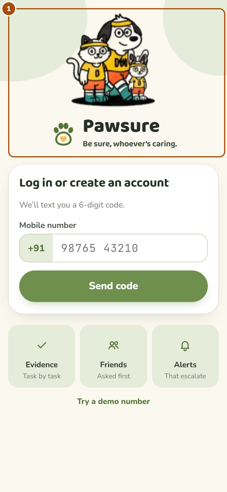

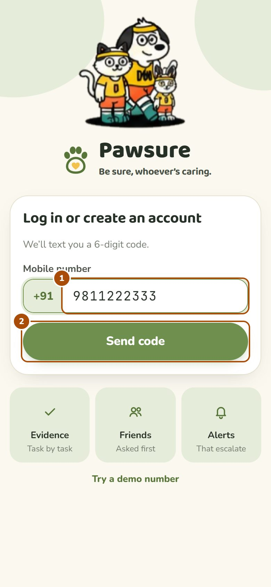

| # | Item | What it does |
|---|---|---|
| 1 | **Mobile number** | Your 10-digit Indian mobile number (+91 is added for you). Friends never see it. |
| 2 | **Send code** | Sends a 6-digit code by SMS. You can ask for a new code after 30 seconds, and up to 3 codes in 15 minutes. |

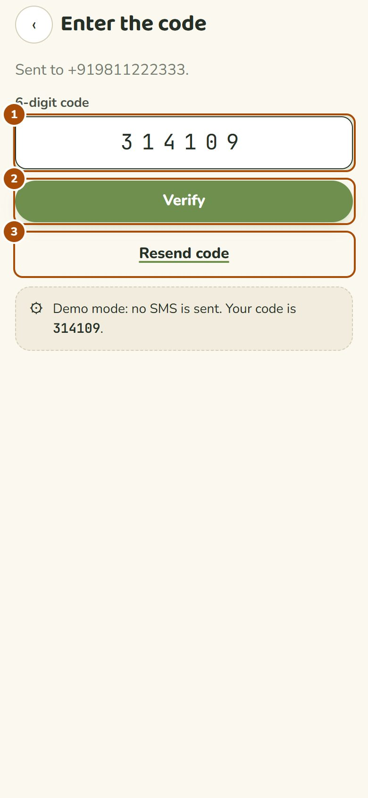

| # | Item | What it does |
|---|---|---|
| 1 | **6-digit code** | The code from the SMS. It expires after 5 minutes. After 5 wrong tries you must ask for a new code. |
| 2 | **Verify** | Signs you in. |
| 3 | **Resend code** | Sends a new code once 30 seconds have passed. Codes you have used don’t count toward the limits, so signing out and straight back in works. |

> [!NOTE]
> In the demo, no SMS is sent: the code is shown on screen.

### 2.3 Terms, privacy and your profile (first sign-in only)

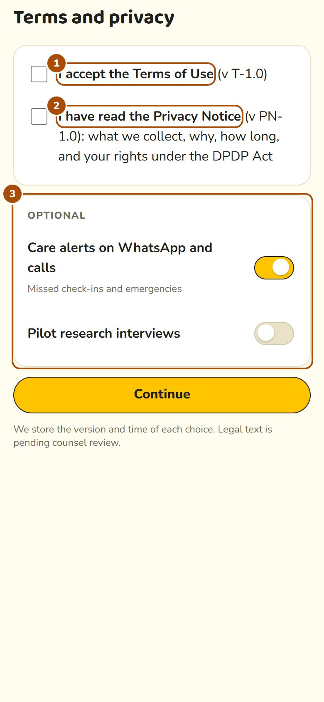

| # | Item | What it does |
|---|---|---|
| 1 | **Terms of Use** | Required. The version you accepted is recorded with the time. |
| 2 | **Privacy Notice** | Required. Explains what Pawsure collects, why, for how long, and your rights. |
| 3 | **Optional** | Care alerts on WhatsApp and calls, and pilot research interviews. You can change these later. |

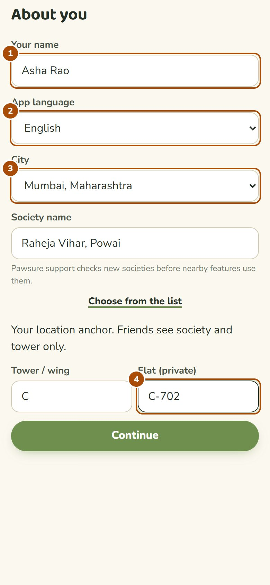

| # | Item | What it does |
|---|---|---|
| 1 | **Your name** | Shown to your care circle and, by first name, to friends you ask. |
| 2 | **App language** | English, Hindi or Marathi. |
| 3 | **City, then society** | Choose your city first, then your society from that city’s list, so a society with the same name in another city is never confused with yours. If yours isn’t listed, tap **My society isn’t listed** and type it; it shows as *Not verified yet* until Pawsure support checks it. Friends see the society and tower only, never a map pin. |
| 4 | **Flat (private)** | Never shown to anyone except a friend you have confirmed for a visit, and a backup you authorised. |

### 2.4 Screen layout

The bottom bar has five tabs: **Today**, **Find cover**, **Friends**, **Pet** and **Me**. **SOS** is always at the top of Today.

### 2.5 Roles and what you see

| Role | What they see in the app |
|---|---|
| Owner | Everything for the household. Only the owner sees the code card. |
| Co-owner | The same as the owner, except the code card and helper records. |
| Backup, family, viewer | A care-circle home: today’s timeline and alerts (section 11). |
| Helper | A helper home explaining how to use WhatsApp (section 12). |
| Friend | Requests sent to them and their own settings (section 13). |

### 2.6 Signing out

**Me → Sign out** ends your session on this phone and clears what was shown, so the next person using the phone sees nothing of yours. **Sign out of all devices** ends every session you have, for example if you lose a phone.

## 3 Today

Today shows who is caring, what is planned, and the evidence for each task as it arrives.

| # | Item | What it does |
|---|---|---|
| 1 | **SOS** | Report an emergency or problem (section 3.6). |
| 2 | **Day status** | *Covered so far*, *Not covered yet*, *Covered day* or *Unknown*. |
| 3 | **Pets** | Each pet in the household. |
| 4 | **Who’s caring today?** | Who is looking after the pets today. Tap **Change**, or **My help can’t come today**. |
| 5 | **Heading out?** | The 30-second leaving checklist (section 3.3). |
| 6 | **Tabs** | Today, Find cover, Friends, Pet and Me. |

### 3.1 Plan and evidence

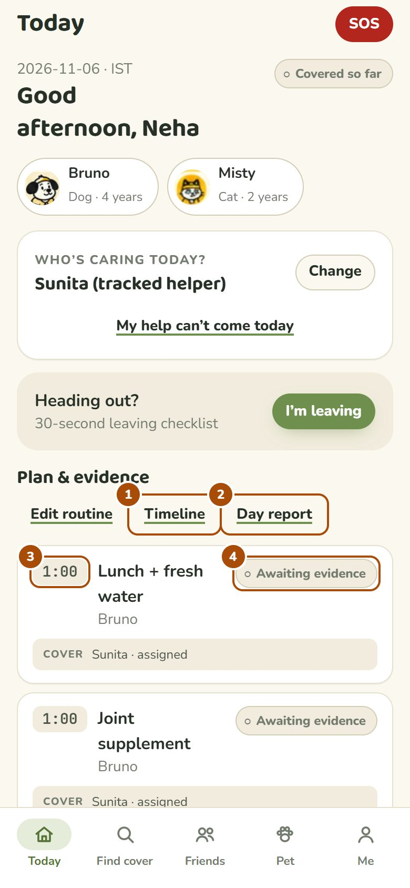

| # | Item | What it does |
|---|---|---|
| 1 | **Timeline** | Everything that happened today, in order: plan, check-ins, alerts and your actions. |
| 2 | **Day report** | A summary of the day you can share with your helper. |
| 3 | **Time** | When the task is due. |
| 4 | **Evidence label** | How strong the evidence is. Tap the task for the reasons (section 3.4). |

Visit evidence (the helper’s arrival and exit calls) is shown above the tasks of that visit, separately from each task’s evidence. A visit alone never confirms a task.

### 3.2 Who’s caring today?

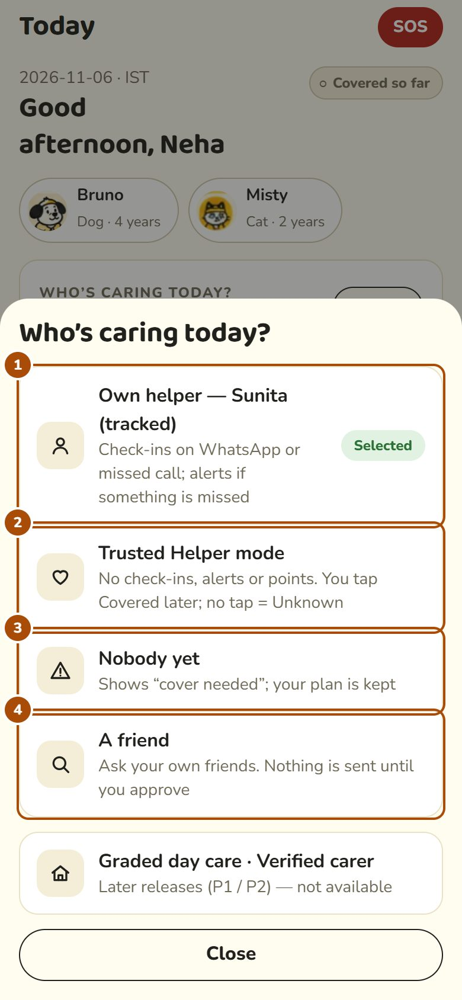

| # | Option | What happens |
|---|---|---|
| 1 | **Own helper (tracked)** | Your helper checks in; you are alerted if something is missed. |
| 2 | **Trusted Helper mode** | No check-ins, alerts or points today. Later, tap **Covered**; if you don’t, the day shows *Unknown*. |
| 3 | **Nobody yet** | Shows *cover needed*. Your plan is kept. |
| 4 | **A friend** | Opens Find cover (section 6). |

**My help can’t come today** marks your helper unavailable for today. The original plan stays in the record, Pawsure warns you if the pets would be alone longer than your limit, and **Ask a friend to cover** opens Find cover with a request already written for the next task.

### 3.3 Leaving and coming back

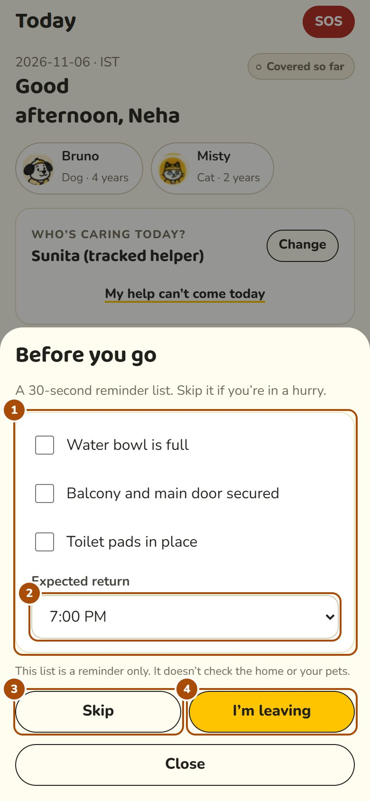

| # | Item | What it does |
|---|---|---|
| 1 | **Checklist** | Water, doors, toilet pads. A reminder only; it doesn’t check anything. |
| 2 | **Expected return** | Used for the alone-window warning and the return check. |
| 3 | **Skip** | Leave without the checklist. |
| 4 | **I’m leaving** | Records that you left. |

When you’re home, tap **I’m back**. If some tasks have incomplete evidence, Pawsure asks a 10-second **return check**.

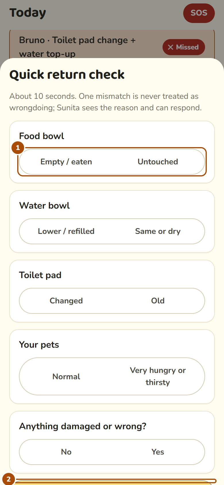

| # | Item | What it does |
|---|---|---|
| 1 | **Questions** | Food bowl, water bowl, toilet pad, your pets, anything damaged. One tap each. |
| 2 | **Save** | A matching answer can mark an unconfirmed task *Matched*. A contradicting answer marks a *Likely* task *Mismatch*: the helper’s points for it are held for review and the helper is told the reason. A mismatch is never treated as wrongdoing. |

### 3.4 When a check-in is missed

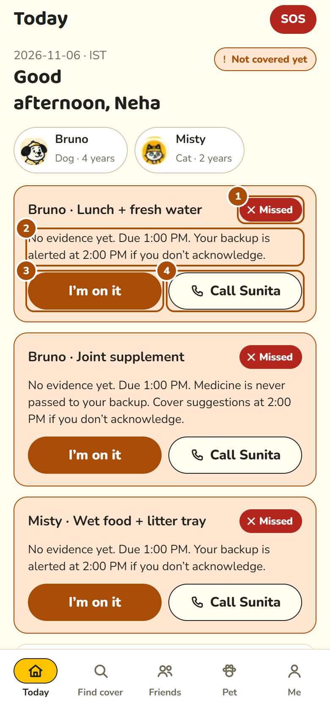

| # | Item | What it does |
|---|---|---|
| 1 | **Label** | *Missed* once the grace period has passed with no evidence. |
| 2 | **What happens next** | When your backup will be alerted if you don’t respond. |
| 3 | **I’m on it** | Stops the next steps. Only this tap (or pressing 1 on a call) counts; a read receipt does not. |
| 4 | **Call Sunita** | Logs that you called; your phone places the call. |

After **I’m on it**, tap **Mark resolved** and say what happened. A missed task resolved before 11:59 PM still counts toward a covered day.

**Escalation timings** (from the task’s due time):

| Task type | Your alert | Backup look-in link | Cover suggestions |
|---|---|---|---|
| Standard (feeding, water, litter, pads) | +30 min | +60 min (open for 15 min) | +75 min |
| Walk | +45 min | +75 min | +90 min |
| Medicine | +15 min | Never (backups never give medicine) | +60 min |

Tap any task to see why it has its label, its escalation ladder and its history:

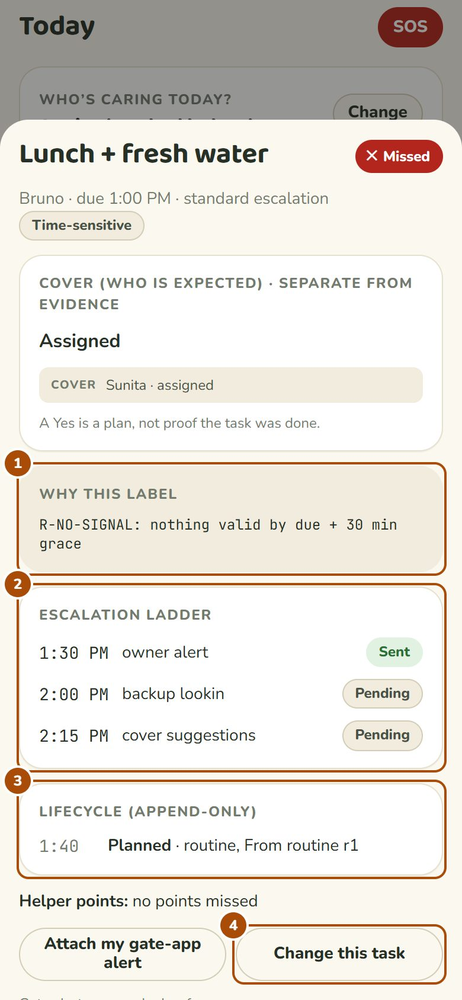

| # | Item | What it does |
|---|---|---|
| 1 | **Why this label** | The evidence rules that produced the label. |
| 2 | **Escalation ladder** | Each step, when it is due, and whether it was sent or stopped. |
| 3 | **Lifecycle** | Every change to the task, in order. History is never overwritten. |
| 4 | **Change this task** | Cancel for today, mark partly done, or skipped, with a reason. A cancelled task is left out of the covered-day count. |

### 3.5 Timeline and day report

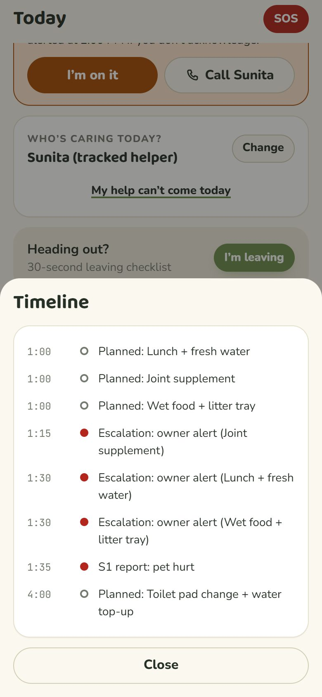

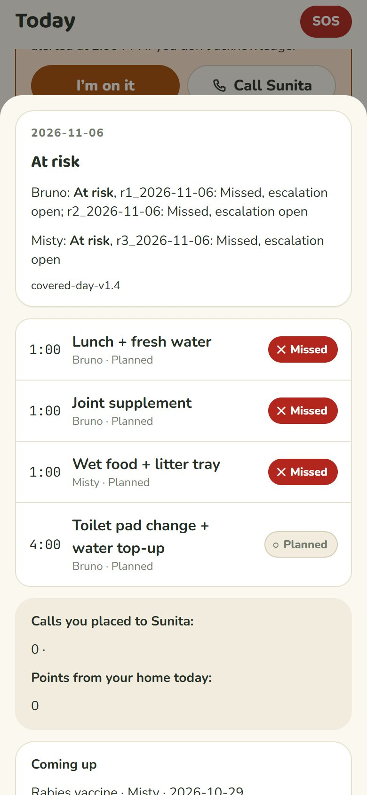

The day report lists each task with its label, the calls you placed, points earned from your home, and upcoming health dates. **Thank Sunita on WhatsApp** opens WhatsApp with a thank-you message.

### 3.6 SOS: reporting a problem

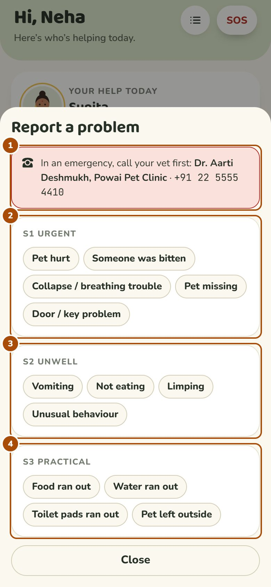

| # | Item | What it does |
|---|---|---|
| 1 | **Call your vet first** | Your vet’s name and number. Pawsure is not an emergency service. |
| 2 | **S1 Urgent** | Pet hurt, bite, collapse or breathing trouble, pet missing, door or key problem. You and your backup are alerted at once by WhatsApp and phone; calls repeat every 5 minutes; at 15 minutes your whole care circle is called; the Pawsure team is told. |
| 3 | **S2 Unwell** | Vomiting, not eating, limping, unusual behaviour. You first; backup after 15 minutes; calls at 30 minutes. |
| 4 | **S3 Practical** | Food, water or pads ran out, pet left outside. You first; backup after 30 minutes. |

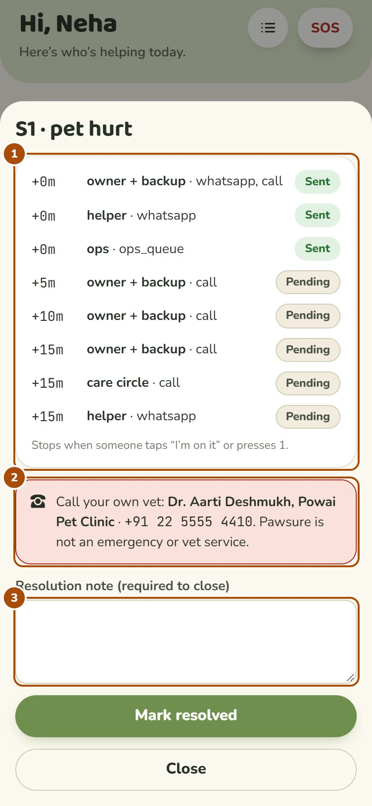

| # | Item | What it does |
|---|---|---|
| 1 | **Who is told and when** | Each step with *Sent*, *Stopped* or *Pending*. Steps stop when someone taps **I’m on it**. |
| 2 | **Your vet** | Call your own vet directly. |
| 3 | **Resolution note** | Required to close the incident. |

### 3.7 When cover is at risk (new in 1.1)

Pawsure now checks *before* a visit that someone is coming, so you hear early and every step has a next step.

**The reminder.** About 90 minutes before each visit (or at 8 PM the evening before, for visits before 10 AM), your helper gets one WhatsApp message in her language: **Yes, I’ll do it**, **Can’t make it** or **Send someone else**. On a basic phone she presses 1, 2 or 3 on the reminder call. She can also write “can’t come” at any time. A co-owner given a task gets the same reminder in the app. A Yes is a plan, not evidence: the task still needs its photo, voice note or code.

**At risk.** A task turns orange (*At risk*) when the caregiver can’t make it, says she can’t come, a friend cancels, or nobody has replied 45 minutes before the task. The card says why and what happens next.

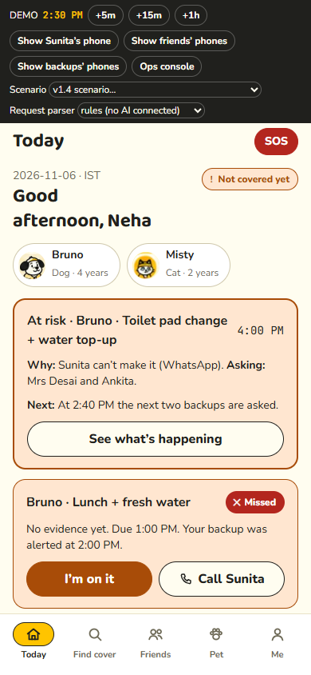

| # | Item | What it does |
|---|---|---|
| 1 | **Why** | The reason: who can’t come, or no reply. |
| 2 | **Asking** | Your backups being asked right now, in your order, two at a time. |
| 3 | **Next** | The next automatic step and when it happens. |
| 4 | **See what’s happening** | Everyone asked, when, their replies and the timers. You can stop the list here. |

**Your backups.** If you turned on *Ask my backups automatically* (Me → Backups), Pawsure asks your list in order, two at a time, 10 minutes per pair, key holders first when someone has to get in. This is the only case where Pawsure contacts people without your tap. If it is off, you get one tap to send. More than 3 hours before the task, everyone on the list is asked together with a 60-minute window, and you can **Ask friends too**.

**Someone says yes.** You get 10 minutes to **Confirm**. For a task that must happen (medicine), a backup you pre-approved is confirmed automatically if you don’t answer. Only then do they get your flat number, the gate note and the key plan. Someone who has not cared for your pet before must first read the pet’s **handling note**.

**Gate and key.** For anyone new to your home, Today shows a checklist: approve them in your gate app (you do this in the gate app; Pawsure has no gate-app integration) and choose the key plan. If it isn’t finished 15 minutes before the visit, you are reminded once.

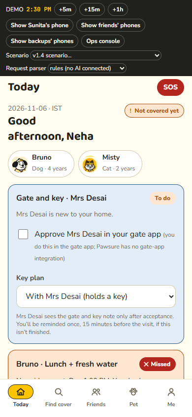

**Cover not found.** If nobody accepts, you get a message and an automated call with the task, who was asked, and when your pet was last fed and given water (from evidence). Choose:

| Option | When it is offered |
|---|---|
| **I’ll handle it** | Always. Reminders stop; your evidence or return check closes the task. |
| **Ask someone else** | Always. Any phone number gets a one-time link for 15 minutes, with the task, time and tower only. Details are shared only after they accept and you approve. |
| **Ask my whole care circle at once** | Once. Everyone on your list who hasn’t said no is asked together. |
| **Find a friend** | Only until 30 minutes before the task (*too close to the task for Friend Finder* after that). |
| **Move it** | Only for tasks that can wait or are time-sensitive (with a warning). |
| **Skip it today** | Only for tasks that can wait. The day is not counted as covered. |

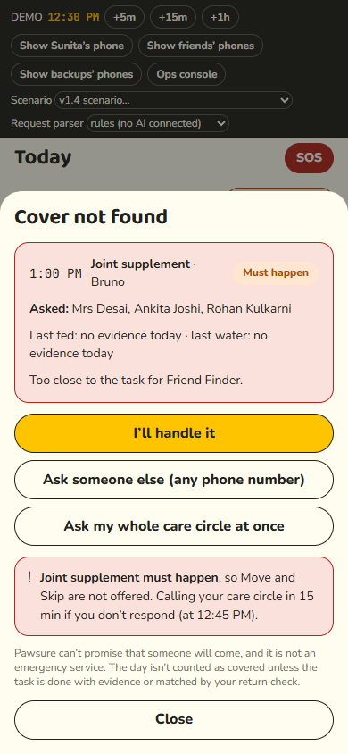

> [!IMPORTANT]
> A task that must happen (medicine, or water on a hot day) can’t be moved or skipped. If you don’t respond within 15 minutes of *cover not found*, everyone in your care circle gets an automated call. Pawsure is not an emergency service and can’t promise that someone will come.

**Send someone else.** If your helper names a substitute, Today asks you to approve or decline. Nothing about your home is shared until you approve; the substitute then gets a one-time link for that task only.

**Before you leave.** If a task today has nobody confirmed, **I’m leaving** first shows who hasn’t accepted and six options: do it before leaving, leave later, take your pet with you, use your own paid provider, ask your circle now, or leave anyway. *Leave anyway* marks the day **No cover planned**: it isn’t counted as covered unless the tasks are done with evidence or matched by your return check. The leaving checklist also asks who your plan B is.

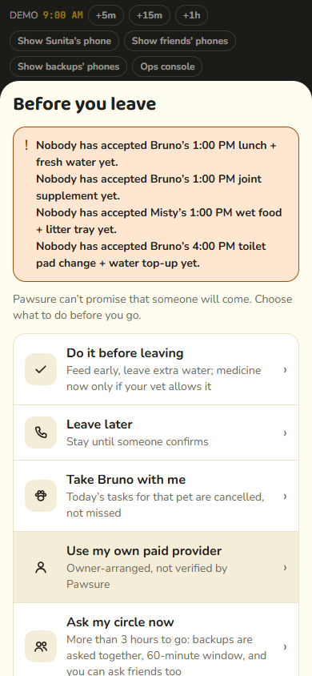

**I’m delayed.** While you’re out, tap **I’m delayed** and choose your new return time. Pawsure shows the tasks that now fall while you’re out, the alone-window check and any medicine, then asks your helper first: *Yes*, *Only until …* or *Can’t*. Anything she can’t cover becomes a request for that part only. You can do this more than once; it is never guessed from your location.

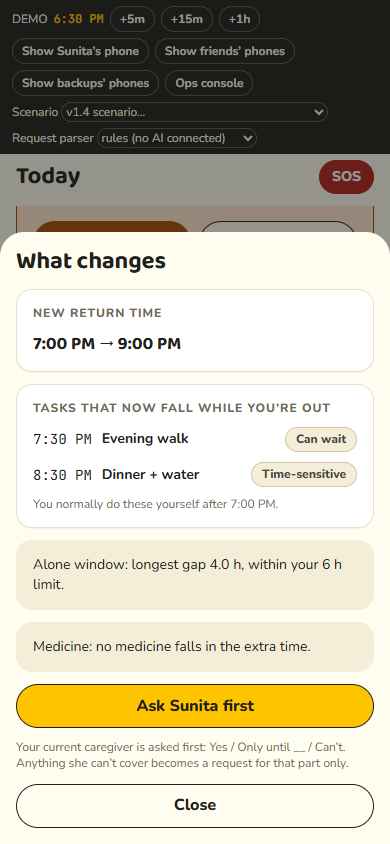

The **day report** has a **Cover history**: the original plan, everyone asked, who covered which part, any delay, and whether no cover was planned.

### 3.8 Backups (Me → Backups)

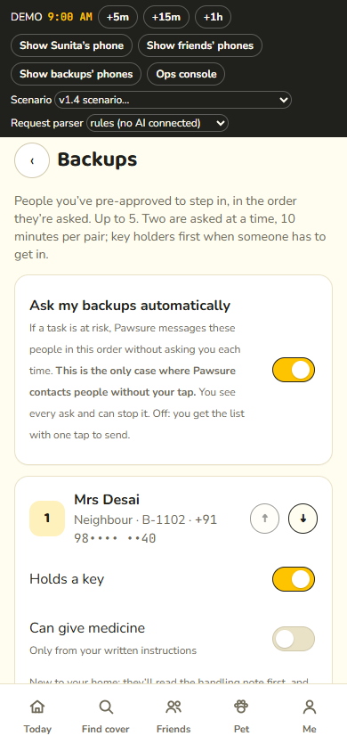

| # | Item | What it does |
|---|---|---|
| 1 | **Ask my backups automatically** | Standing approval for this list only. Off by default. |
| 2 | **Order** | Up to 5 people, asked in this order (↑ ↓). |
| 3 | **Holds a key** | Key holders are asked first when someone has to get in. |
| 4 | **Can give medicine** | Only these people are asked for medicine tasks, from your written instructions. |
| 5 | **Owner-arranged** | Your own paid walker or sitter, shown as *owner-arranged, not verified by Pawsure*. |
| 6 | **Reminder in Trusted Helper mode** | Off by default. |
| 7 | **Hot day** | Makes water tasks *must happen* today. |

If fewer than two people on your list hold a key, Me shows **Your circle is thin** once a week. New to the area with nobody to ask? During sign-up Pawsure asks “Do you have anyone who can look in on your pet?” and offers four ways to build a circle: an invite link for your society WhatsApp group, a pet-parent swap with another owner, a helper who already works in your building (her consent first), or your own paid provider. It does not show a list of day cares.

Each routine task also has an **urgency** (Pet → Routine): *Can wait* (walk, play), *Time-sensitive* (meals) or *Must happen* (medicine). The pet profile has a **handling note** (for example: nervous with strangers, slips out at the door) that first-time carers must read before they accept.

## 4 Pet

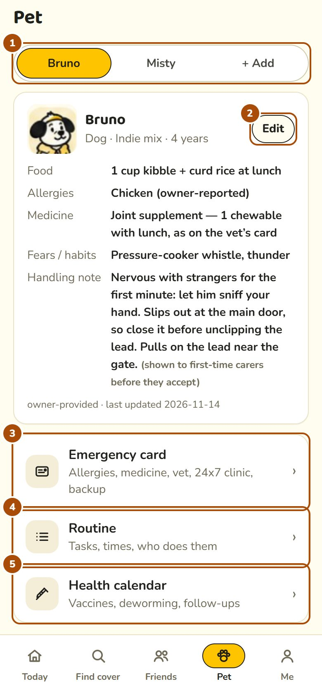

| # | Item | What it does |
|---|---|---|
| 1 | **Pets** | Switch between pets, or **+ Add** a pet. Required: name, food and feeding, allergies, medicine instructions, and your vet’s name and phone (*None* is a valid answer). Breed, age, fears, notes, 24x7 clinic and backup are optional. |
| 2 | **Edit** | Food, allergies, medicine instructions, fears, vet, 24x7 clinic, backup contact. Saved as owner-provided with the date. |
| 3 | **Emergency card** | Allergies, medicine, vet, 24x7 clinic and backup on one screen. |
| 4 | **Routine** | The daily tasks (section 4.2). |
| 5 | **Health calendar** | Vaccines, deworming and follow-ups (section 4.3). |

### 4.1 Emergency card

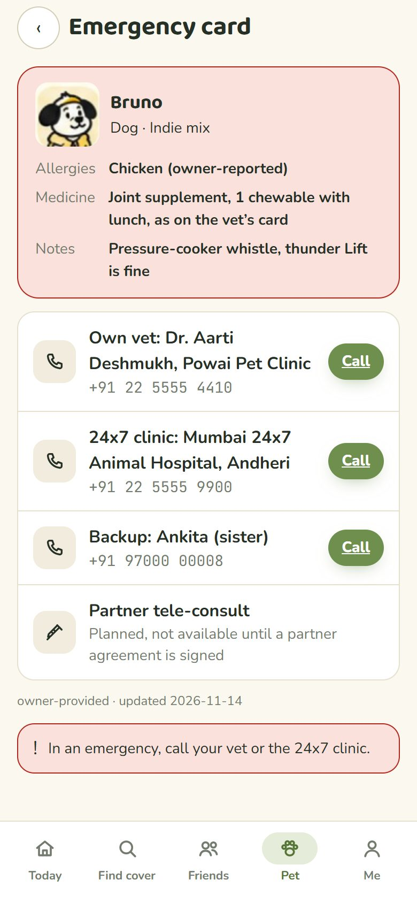

Helpers see the emergency card during a visit or incident; a confirmed friend sees it during their visit; a backup sees it through the look-in link. Medicine instructions are copied from your vet; Pawsure never suggests doses.

### 4.2 Routine

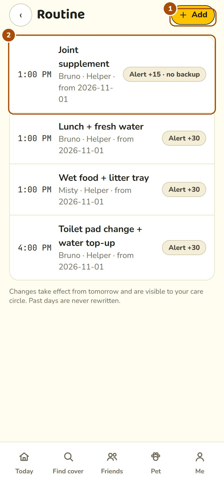

| # | Item | What it does |
|---|---|---|
| 1 | **Add** | A new task: pet, name, type, time, urgency, who does it (helper, co-owner or you), instructions, and **When**: *Every day, from tomorrow* or *Just for today*. |
| 2 | **Task** | Tap to edit. |

You can also reach this screen from Today: **Edit routine**, next to *Plan & evidence* (owners and co-owners).

Changes take effect from **tomorrow**. Today’s plan and past days are never rewritten. The one exception is a new task marked **Just for today**: it is added to today’s plan at once, is listed as *today only*, and does not repeat. To change a task that is already in today’s plan, tap it on Today → **Change this task**: cancel it for today, mark it partly done or skipped, always with a reason that stays in the history.

### 4.3 Health calendar

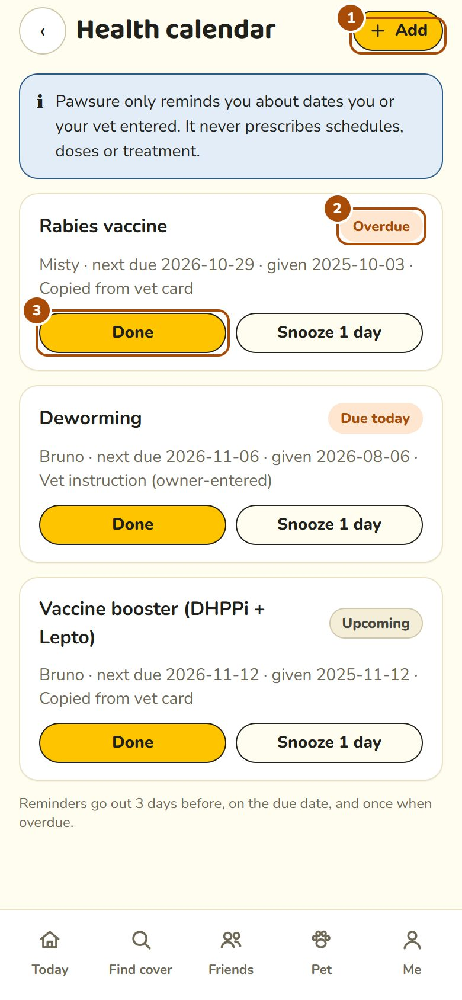

| # | Item | What it does |
|---|---|---|
| 1 | **Add** | A date from your vet card: type, name, given on, next due, source. |
| 2 | **State** | *Upcoming*, *Due soon*, *Due today*, *Overdue*, *Snoozed* or *Done*. |
| 3 | **Done / Snooze 1 day** | Mark it done, or snooze the reminder. |

Reminders go out 3 days before, on the due date, and once when overdue. Pawsure only reminds you of dates you or your vet entered.

## 5 Helper and code card

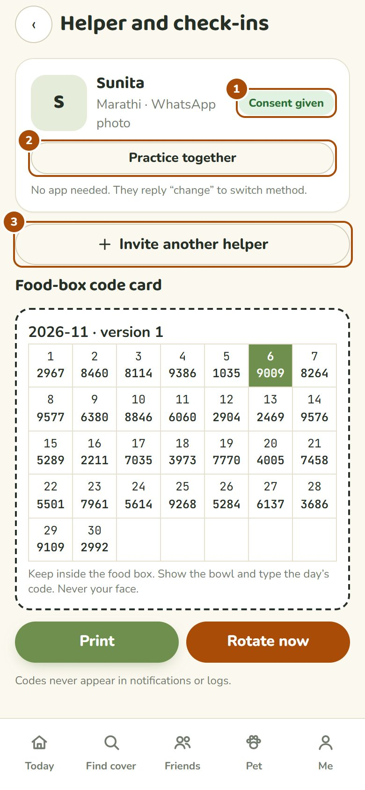

| # | Item | What it does |
|---|---|---|
| 1 | **Consent status** | *Waiting for a reply*, *Consent given*, *Said “Not now”* or *Stopped check-ins*. Nothing is recorded until the helper says Yes. |
| 2 | **Practice together** | Sends a practice prompt; nothing is recorded as evidence. |
| 3 | **Invite another helper** | Name, phone and their language. The invitation goes on WhatsApp. |

If your helper says *Not now* or stops, nothing about them is recorded. Use **Trusted Helper mode** or your own return check; their tasks show *Not confirmed*, never *failed*.

### 5.1 The code card

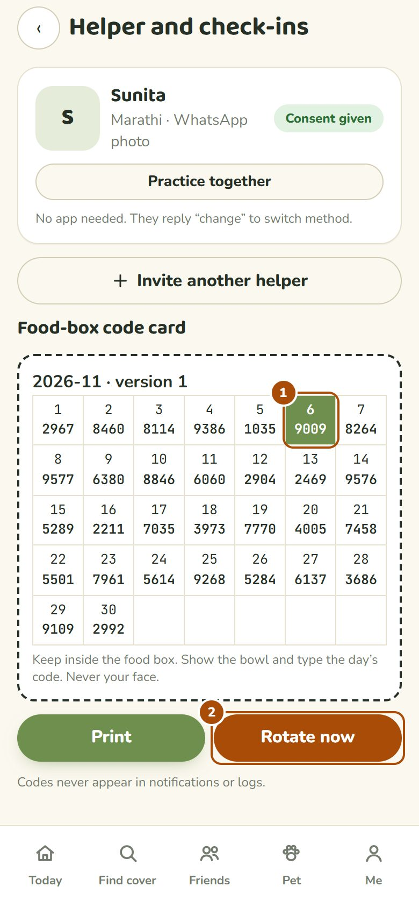

| # | Item | What it does |
|---|---|---|
| 1 | **Today’s code** | Highlighted. The helper types it in the photo caption or keys it on the IVR call. |
| 2 | **Rotate now** | Makes a new card at once; the old codes stop counting. Print the new card before the next visit. |

A new card is made automatically each month. Codes are encrypted, checked on the server, and never appear in messages or logs.

## 6 Find cover

Ask in your own words. Pawsure understands the request, checks your own friends, and sends nothing until you approve.

> [!NOTE]
> **How requests are understood**
>
> No AI model is connected in this release. Requests are understood by rules, and the request screen says so (*understood by rules (no AI connected)*). Choosing which friends to suggest never uses AI: it uses who opted in, who is free, the tasks they chose, distance and key arrangements.

### 6.1 Ask

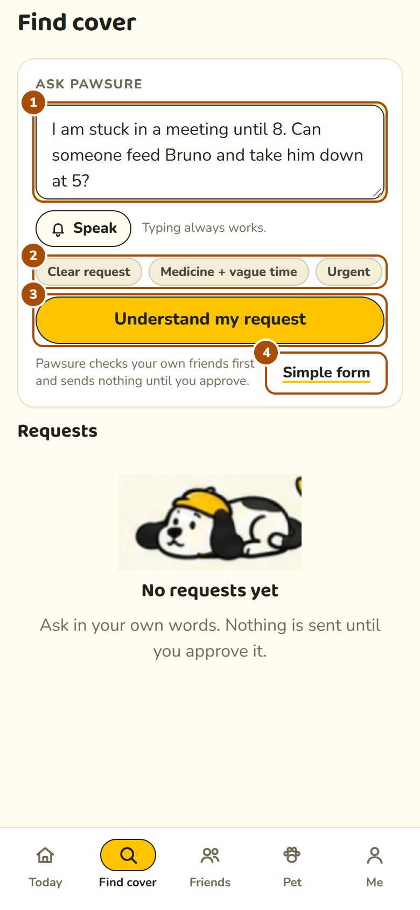

| # | Item | What it does |
|---|---|---|
| 1 | **Describe what you need** | For example *Can someone feed Bruno and take him down at 5?* **Speak** works in supported browsers; typing always works. |
| 2 | **Examples** | Sample requests to try. |
| 3 | **Understand my request** | Shows what Pawsure understood for you to check. |
| 4 | **Simple form** | Pick tasks, pet, time and key arrangement instead of typing. Matching works the same. |

### 6.2 Check the details

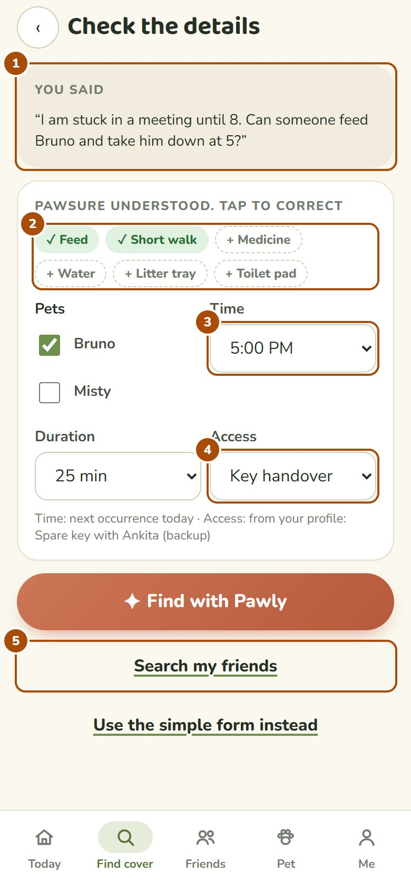

| # | Item | What it does |
|---|---|---|
| 1 | **You said** | Your words, unchanged. |
| 2 | **Tasks** | Tap to add or remove. |
| 3 | **Time** | Corrected if needed. If the time has passed or is unclear, Pawsure asks. |
| 4 | **Access** | Key handover, someone at home, or friend has key. |
| 5 | **Search my friends** | Blocked until any highlighted questions are answered. |

Medicine requests only go to friends who chose *Medicines*, and they get your written instructions.

**Several pets** (new in the 14 Nov update): with more than one pet, tick each pet the friend should look after, here or on the simple form (or write “both” or the names). Pawsure suggests only friends who said they can look after that many pets at once and that kind of pet. The message names every pet, and medicine instructions are quoted per pet.

### 6.3 Suggestions

**Find with Pawly** runs the search with its steps on screen: reading your request, checking who is free, matching tasks, pets and keys, and picking the closest friends. Pawly is the friendly name for Pawsure’s friend search; it follows the same rules as **Search my friends** and sends nothing until you approve.

If nobody is free, the **No friend is free right now** page offers: try another time, search any distance, invite a friend, or call your backup.

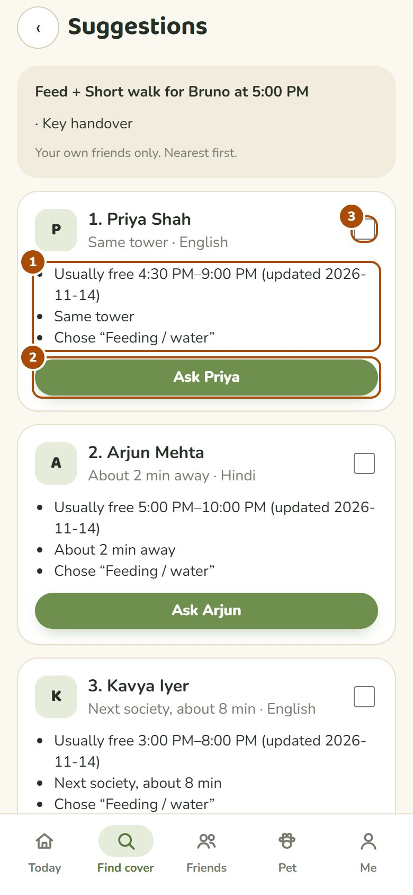

| # | Item | What it does |
|---|---|---|
| 1 | **Why this friend** | Distance band, free time, task choice, key readiness, consented reply history. |
| 2 | **Ask (name)** | Ask this one friend. |
| 3 | **Select** | Tick several, then **Ask these** or **Ask all 3**. |

**Friends not shown — why** gives counts only (for example *1 · Paused requests*); names are never shown, and declining never counts against anyone. If nobody is free, Pawsure says so honestly and suggests a different time or widening the distance. Nearby Pawsure members are switched off until identity checks are approved.

### 6.4 Approve the message

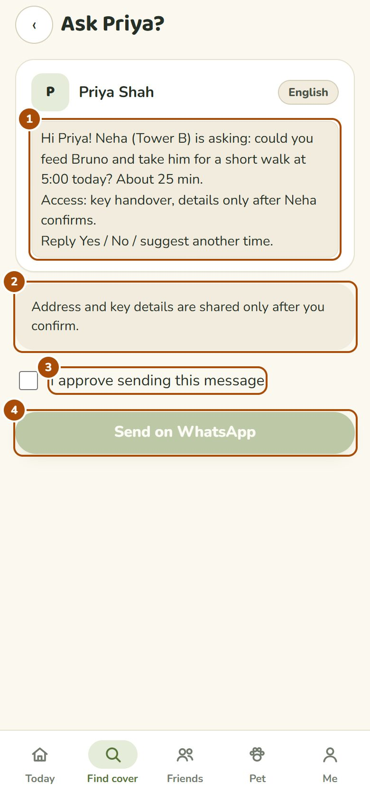

| # | Item | What it does |
|---|---|---|
| 1 | **Message** | Exactly what the friend will receive, in their language, with the meaning in English. |
| 2 | **Not included** | Flat number, key location, emergency card and when the home is empty are not shared until you confirm someone. |
| 3 | **I approve** | Required before anything is sent. |
| 4 | **Send on WhatsApp** | Sends the request. |

With **Ask all 3**, the first valid Yes is held for 10 minutes while you confirm; the others see *waiting for the owner to confirm*, and are closed politely once you confirm.

### 6.5 Follow and confirm

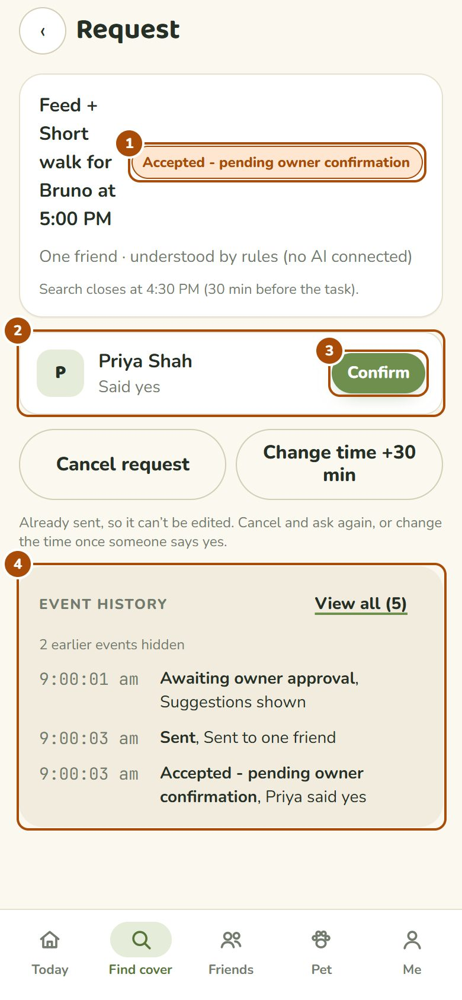

| # | Item | What it does |
|---|---|---|
| 1 | **State** | *Sent*, *Provisional hold*, *Accepted - pending owner confirmation*, *Confirmed*, *Completed*, *Declined*, *Expired*, *Cancelled*, *No-show*, *Interrupted* (the friend had an emergency and left; what they finished is shown and your backups are asked). |
| 2 | **Friend** | Their reply: waiting, said yes, suggested another time, declined. A request expires after 15 minutes without a reply (reminder at 8). |
| 3 | **Confirm** | Confirms the friend. If they suggested another time, the button says **Confirm 5:30** and nothing changes until you tap it. |
| 4 | **Event history** | The latest three steps with their exact time (to the second); **View all** shows every step. |
| 5 | **Edit request** | Shown until the request is sent: opens *Check the details* again. After it is sent, cancel and ask again, or use **Change time** once a friend has said yes. |

Tapping a button twice, or a retry on a slow connection, never sends anything twice. If you already have a request out to friends for the same pet at about the same time, Suggestions says so and offers **Open it**; a second one can’t be sent. If you change the pet’s profile (for example the medicine instructions) before the request is sent, *Check the details* says so and the search uses the new details. Changing the pet on a medicine request uses that pet’s own instructions, never the previous pet’s.

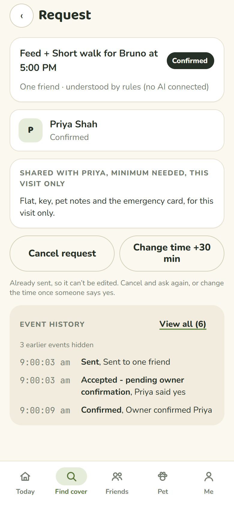

Once confirmed, the friend sees the flat number, key arrangement, pet notes and emergency card for this visit only; access is removed when they tap **Done**, cancel, or 2 hours after the task. A cover task appears on Today. If your helper was unavailable, only the matching tasks (same pet, same kind of task) move to the friend; anything else stays open and still alerts you. If the friend sends nothing by 20 minutes after the task time, the request becomes *No-show* and your backup is alerted. If the friend said they are running late, you see the new arrival time and the no-show alarm waits for it (up to 80 minutes after the task).

Search closes 30 minutes before the task. **Cancel request** and **Change time +30 min** are available while it is open; a time change asks the friend to reconfirm.

## 7 Friends

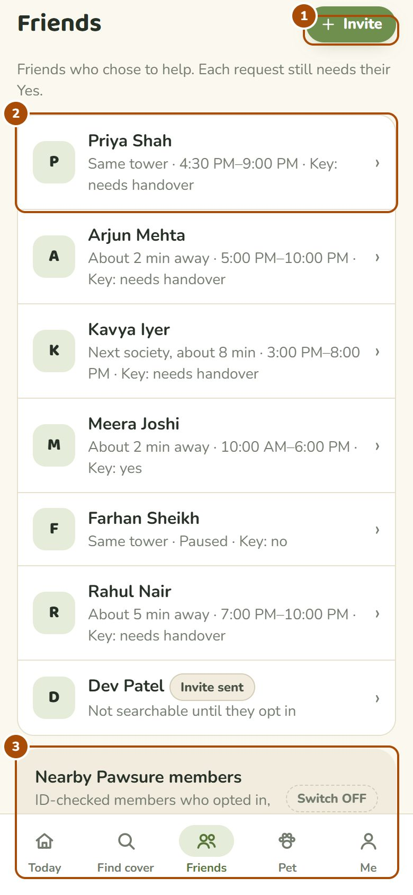

| # | Item | What it does |
|---|---|---|
| 1 | **Invite** | Name, phone and message language. An invitation is not the same as opting in: they choose whether to be findable, what they help with and when. |
| 2 | **Friend** | Distance band, usual free time and key arrangement. Tap for their profile. |
| 3 | **Nearby members** | Switched off until identity checks are approved. |

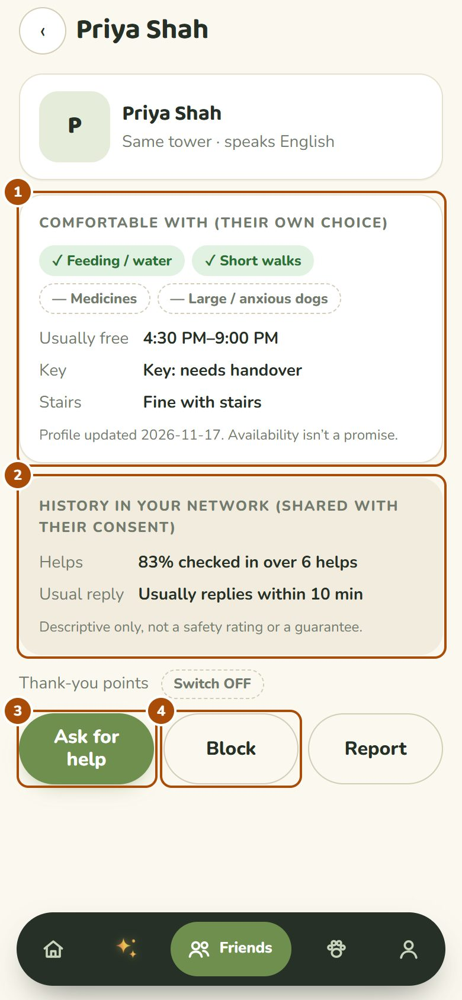

| # | Item | What it does |
|---|---|---|
| 1 | **Comfortable with** | Tasks they chose themselves. |
| 2 | **History** | Helps and usual reply time in your network, shared with their consent. |
| 3 | **Ask for help** | Opens Find cover with a request for them. |
| 4 | **Block / Report** | Block removes them from your searches without telling them why. Report also blocks them and asks the Pawsure team to review within 24 hours. |

### 7.1 What friends can see

**Me → Profile and what friends see** shows your name, city, society, tower and (to owners only) your flat. **Edit profile** changes any of them. Every owner of the home is told when the address changes, and a friend already confirmed for a visit sees the new address. The same screen lists what is visible and what is hidden until you confirm someone. Location sharing is *society only* by default; you can widen it to *society + tower*. There is no public map and never an exact pin.

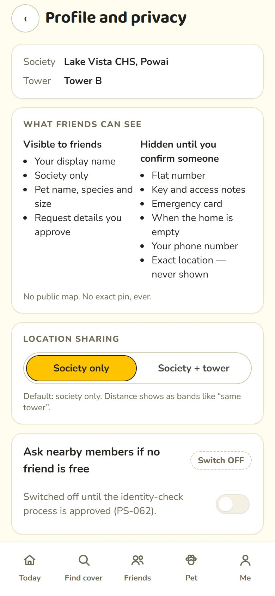

## 8 Me: wallet, data rights and consents

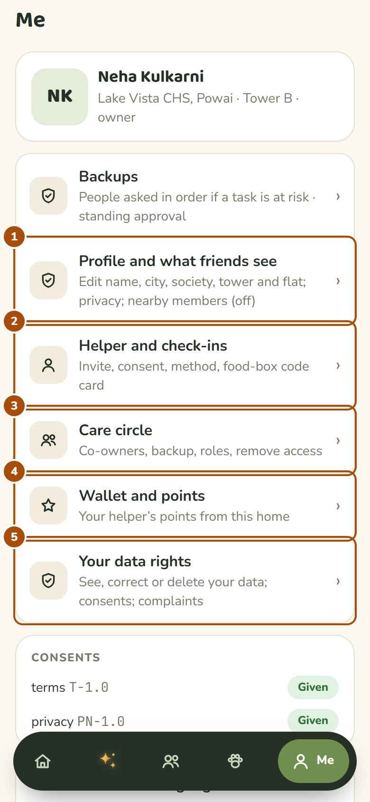

| # | Item | What it does |
|---|---|---|
| 1 | **Profile and what friends see** | Section 7.1. |
| 2 | **Helper and check-ins** | Section 5. |
| 3 | **Care circle** | Section 10. |
| 4 | **Wallet and points** | Section 8.1. |
| 5 | **Your data rights** | Section 8.2. |

### 8.1 Wallet and points

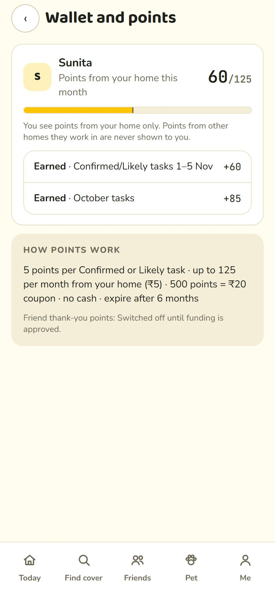

Your helper earns **5 points** for each task with *Confirmed* or *Likely* evidence, up to **125 points a month from your home** (₹5). **500 points = a ₹20 coupon.** There is no cash, and points expire after 6 months. You see points from your home only, never from other homes your helper works in. Points are being tested in half of the pilot homes; if they are off for your home, check-ins work the same.

### 8.2 Your data rights

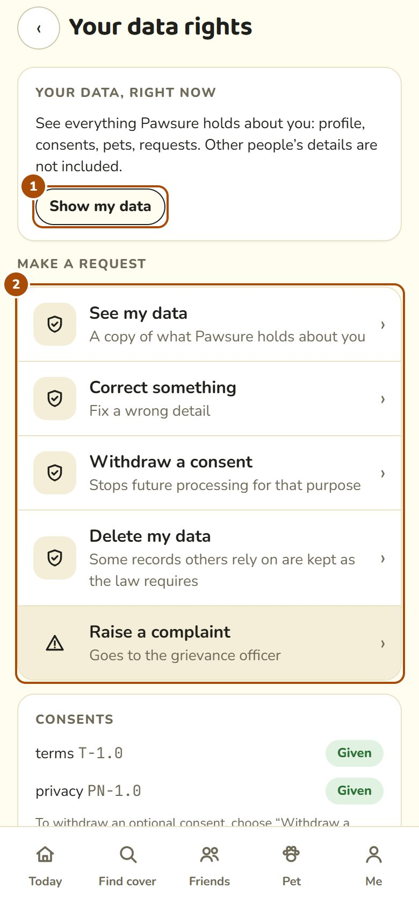

| # | Item | What it does |
|---|---|---|
| 1 | **Show my data** | Shows everything Pawsure holds about you (profile, consents, pets, requests). Other people’s details are not included. |
| 2 | **Make a request** | See, correct, withdraw a consent, delete, or complain. Pawsure aims to reply within 7 days; the legal limit is 90 days. |

Your consents are listed with their versions under **Me**. Withdrawing an optional consent stops future use; records other people rely on (such as an incident) are kept only as long as the law requires.

## 9 Asking a friend: end-to-end example

1. **Find cover** → type *Can someone feed Bruno at 5 pm?* → **Understand my request**.
2. Check the details → **Search my friends**.
3. **Ask Priya** → tick **I approve** → **Send on WhatsApp**.
4. Priya taps **Yes** on WhatsApp (or in her app).
5. You tap **Confirm**. Priya now sees the flat and key details for this visit.
6. Priya taps **I’ve arrived** and then **Done**. The request shows *Completed* and access is removed.

## 10 Care circle

How helpers and friends join is in 12.1 and 13.1.

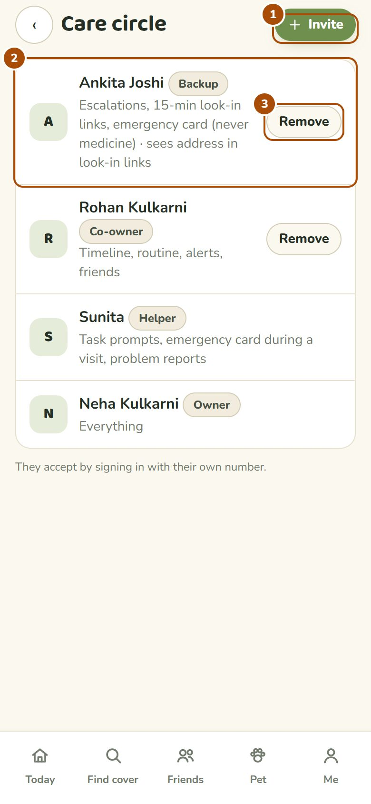

| # | Item | What it does |
|---|---|---|
| 1 | **Invite** | Name, phone and role: co-owner, backup, family or viewer. They accept after signing in with their own number. |
| 2 | **Member** | Their role and what it allows. |
| 3 | **Remove** | Removes access in the app, WhatsApp alerts and any open look-in links, within 60 seconds. Past actions stay in the history. |

## 11 For backups and family

When you sign in as a backup, family member or viewer, you see your care-circle home: today’s timeline and any open alerts, which you can acknowledge with **I’m on it**.

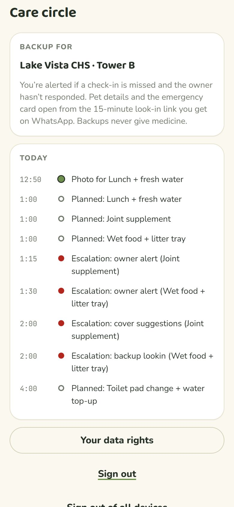

If a check-in is missed and the owner hasn’t responded, a backup gets a **15-minute look-in link** on WhatsApp:

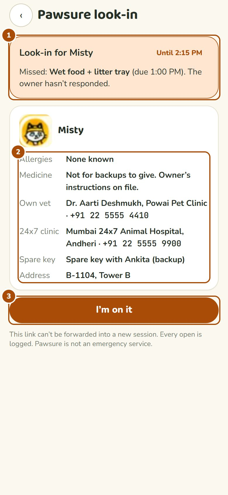

| # | Item | What it does |
|---|---|---|
| 1 | **What was missed** | The task, its due time, and until when the link is open. |
| 2 | **Pet card** | Allergies, vet, 24x7 clinic and the spare-key note. Medicine is never for backups to give. The address shows only if the owner authorised it. |
| 3 | **I’m on it** | Tells the owner you’re handling it. |

The link works only for the person it was sent to, every open is logged, and it stops working after 15 minutes or if your access is removed.

## 12 For helpers

### 12.1 How a helper joins

A helper can’t sign up on their own. The owner invites them, and nothing about the helper is recorded until they say Yes.

| Step | Who | What happens |
|---|---|---|
| 1 | Owner | **Helper and code card → Invite another helper**: the helper’s name, mobile number and language. |
| 2 | Helper | Gets a WhatsApp message in that language explaining what Pawsure records: only the bowl or the pet, never their face, and only for this home. They can switch language first. |
| 3 | Helper | Replies **Yes**: the consent is recorded with its version and time, the helper becomes active and the owner is told. Replies **Not now**: nothing is recorded; the owner can use Trusted Helper mode or check-ins they make themselves. |
| 4 | Helper | Chooses how to check in: **photo**, **voice note** or **missed call** with the day’s code. Reply **change** to switch later. |
| 5 | Owner (optional) | **Practice together** sends a practice prompt so the helper can try it; nothing from the practice counts as evidence. |
| 6 | Helper | From now on uses WhatsApp or a basic phone. No app is needed. **stop** ends check-ins at any time; **start** asks for consent again. |

A helper can also sign in to the app with their own number and a one-time code. They see only the helper home below, never the owner’s screens.

### 12.2 Day to day

Helpers don’t need the app. Everything works on WhatsApp or a basic phone:

- **Invitation:** a WhatsApp message in your language asks whether you want to join. Only the bowl or the pet is ever photographed, never your face. Reply **Yes** or **Not now**.
- **Method:** photo, voice note, or missed call with the day’s code. Reply **change** to switch.
- **Task prompts:** a message 10 minutes before each task. Send a photo of the bowl with today’s code from the card, a voice note, or give a missed call and key the code.
- **Replies:** **points** shows your points; **share** gives a link to your record (counts only, when switched on); **my data** asks what Pawsure holds; **delete my data** asks for deletion and stops check-ins; **stop** stops check-ins; **help** asks a person to call you back.
- **Problems:** use the problem buttons (pet hurt, water ran out and so on); the owner and backup are told.

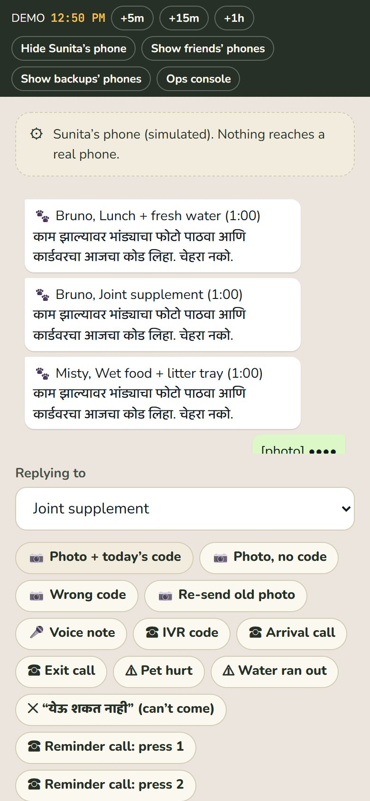

If you sign in to the app with your number, you see the helper home with these instructions and your data rights. The society and tower shown belong to the owner’s profile; if they are wrong, tap **Wrong society or tower? Tell the owner**:

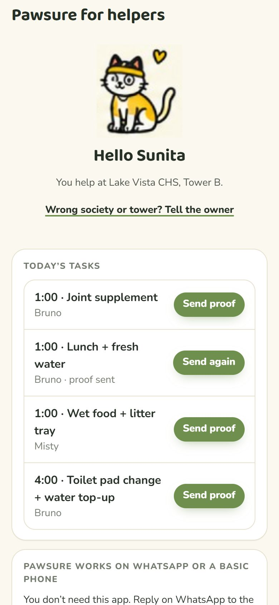

**Before each visit** (new in 1.1) you get one message in your language asking if you will come: tap **Yes, I’ll do it**, **Can’t make it** or **Send someone else** (on a basic phone, press 1, 2 or 3 on the call). If something comes up later, write “can’t come” (or “येऊ शकत नाही” / “नहीं आ पाऊँगी”) at any time, or press 2 on the missed-call line. The owner is told at once and you get no more messages for that visit. Saying you can’t come is never held against you. If you send someone else, write their name and number; nothing about the home is shared with them until the owner approves.

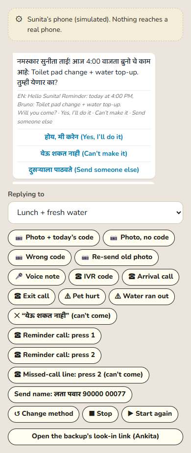

## 13 For friends

### 13.1 How a friend joins

A friend can’t sign up on their own either. The owner invites them, and being invited is not the same as being findable.

| Step | Who | What happens |
|---|---|---|
| 1 | Owner | **Friends → Invite**: the friend’s name, mobile number and message language. Up to 20 invites a day. |
| 2 | Friend | Gets a WhatsApp invitation with **Set up my profile**. Tapping it (or **Accept** in the app) connects them to the owner. They are still not findable. |
| 3 | Friend | Signs in to the app with their own number and a one-time code, and opens **My settings**. |
| 4 | Friend | Turns on **Friends can find me**. This is their consent to be suggested, recorded with the time; turning it off removes them from search at once. |
| 5 | Friend | Sets when they are usually free, the tasks they are comfortable with (feeding, walks, medicines, large dogs), how many pets at once and which kinds, keys, stairs and message language. |
| 6 | Friend | From now on, requests arrive on WhatsApp (and in **Requests for you**). They reply Yes, No or another time. The flat, key and emergency card are shown only after the owner confirms them, for that visit only. |

A friend needs WhatsApp. A friend with only a basic phone can’t be set up yet (backups and helpers can use a basic phone).

### 13.2 Day to day

Friends receive requests on WhatsApp in their language and can reply **Yes**, **No**, or suggest another time (for example *5:30*). In the app, a friend sees **Requests for you** and **My settings**.

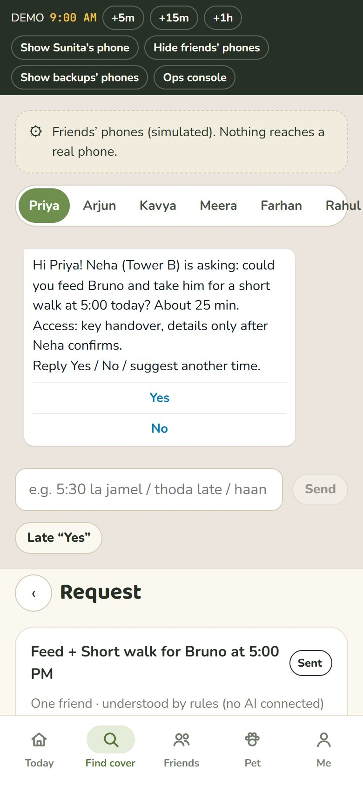

After the owner confirms you, **Show address, key and emergency card** reveals the details for that visit only. Tap **I’ve arrived** when you get there and **Done** when finished; tap **Can’t make it** if plans change (the owner is told and the details are removed).

**Running late?** Choose how late and tap **I’m running late** (or write “late 20” on WhatsApp or SMS). The owner gets your new arrival time.

**Emergency?** Tap **Emergency — I have to leave**, tick what you already finished and send. The owner and co-owner are alerted and called, their backups are asked at once, and the visit is marked *interrupted* (never *done*). On WhatsApp or SMS, write “emergency” (for example “emergency, done feed”).

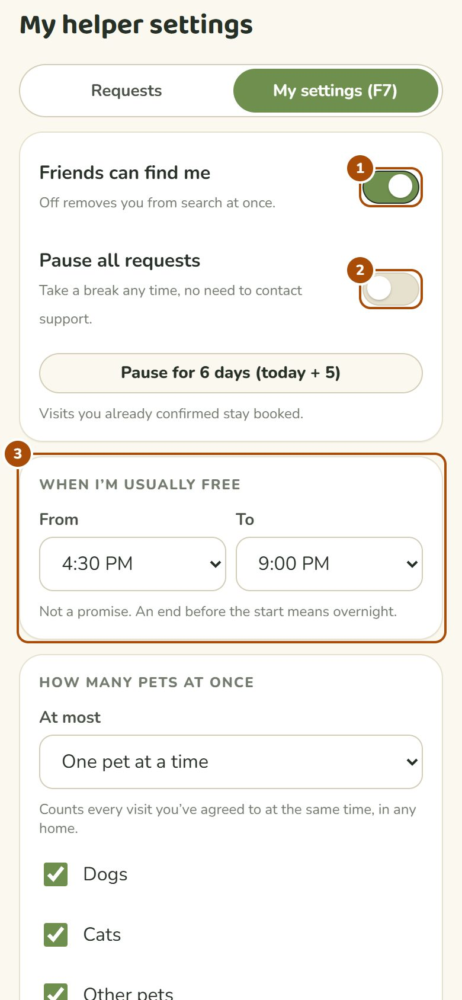

| # | Item | What it does |
|---|---|---|
| 1 | **Friends can find me** | Turning it off removes you from search at once. |
| 2 | **Pause all requests** | Take a break any time, or **Pause for 6 days** (today counts as day 1). While paused, the switch shows the last paused day and the day requests return; turn it off to come back early. Visits you already confirmed stay booked, and your friends still see you, marked *Paused*. |
| 3 | **When I’m usually free** | Shown as “usually free”, with when you last updated it. Not a promise. An end time before the start means overnight, for example 9 PM to 6 AM (next day). |
| 3a | **How many pets at once** | One to four, counted across every visit you’ve agreed to at the same time, and which kinds of pets (dogs, cats, other). |
| 4 | **Tasks I’m comfortable with** | Feeding and water, short walks, medicines (only with written instructions), large or anxious dogs. |

Keys, message language, stairs, live location (off by default, only during an accepted visit) and the separate nearby-members opt-in are also here.

## 14 Status reference

| Label | Meaning |
|---|---|
| Awaiting evidence | Not due yet, or within its window. |
| Likely | One good signal, such as a photo with today’s code, a voice note naming the task, or the IVR code after a prompt. |
| Confirmed | Two independent channels, such as a photo with code plus arrival and exit calls long enough for the tasks. |
| Not confirmed | Evidence was weak or contradictory, for example a wrong code or a reused photo. |
| Not confirmed (visit only) | The helper’s visit was recorded but there is no evidence for this task. It escalates like a missed task. |
| Missed | No evidence by the end of the grace period. |
| Matched (owner check) | Your return check confirmed it. No helper points. |
| Mismatch — under review | Your return check contradicted a Likely task. Points held for review; never treated as wrongdoing. |
| Trusted helper — no check-ins | Trusted Helper mode. |
| Cancelled / Skipped / Partly done | Changed by you, with a reason. |
| Reassigned | Moved to a friend who covered it. |

| Day status | Meaning |
|---|---|
| Covered so far | Every task due so far has evidence or is resolved. |
| Covered day | The day closed with every pet’s tasks done or resolved. |
| Not covered yet / Not covered | At least one task is missed and unresolved. |
| Unknown | Trusted Helper mode with no **Covered** tap. |

## 15 Glossary

| Term | Meaning |
|---|---|
| Acknowledge | Tapping **I’m on it** (or pressing 1 on a call). Stops the next escalation steps. |
| Covered day | See section 1.4. Stored each night with the rule version used. |
| IVR | The automated phone line where a helper keys the day’s code. |
| Look-in link | A 15-minute link for a backup, scoped to one person. |
| Return check | A 10-second set of questions when you get home. |
| Trusted Helper mode | A day without monitoring, alerts or points. |

## 16 Appendix A: practise with the demo

The shared demo runs the whole app in your browser with the demo household; nothing is sent anywhere and it resets when you reload. Sign in with these numbers (the code appears on screen):

| Who | Number |
|---|---|
| Neha (owner) | 98000 00021 |
| Rohan (co-owner) | 98000 00022 |
| Ankita (backup) | 97000 00008 |
| Sunita (helper) | 90000 00035 |
| Priya (friend) | 99000 00012 |
| Arjun (friend, Hindi) | 98000 00077 |
| Meera (friend, Marathi) | 97000 00090 |

The demo tools are hidden so the app looks like the real thing. On a laptop, tap **Demo tools** at the bottom left of the page (on a phone, add **#tools** to the address). A bar then appears at the top: move the clock forward (**+5m**, **+15m**, **+1h**), open **Sunita’s phone**, the **friends’ phones** or the **backups’ phones** to reply as them, or open the **Ops console**. Tap **Hide demo tools** to hide it again.
